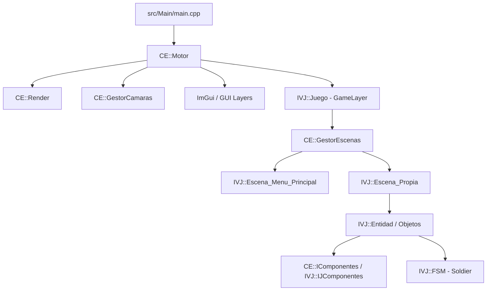

# Guía del Desarrollador y Agente Antigravity - CimaEngine3v

> [!IMPORTANT]
> Este archivo es la **fuente de verdad técnica y arquitectónica** de `CimaEngine3v` / *"Expendable"*. Todo agente de IA (Antigravity / Gemini) que trabaje en este repositorio debe leer y respetar las pautas, convenciones y advertencias aquí detalladas.

---

## 1. Visión General del Proyecto

- **Nombre del Motor:** `CimaEngine3v`
- **Juego Actual:** *Expendable* (Título configurado en la ventana y escenas).
- **Lenguaje:** C++17 / C++20 (Compilador GCC 16.2.1 en Linux).
- **Librerías Principales:**
  - **SFML 3** (3.1.x): Gráficos 2D, ventanas, eventos, audio.
  - **Dear ImGui** (`v1.91.9b-docking`): GUI de depuración, docking y viewports desacoplados.
  - **ImGui-SFML** (`v3.0`): Backend de integración entre ImGui y SFML 3.
- **Sistema de Construcción:** CMake + Ninja Multi-Config.
- **Resolución Base:** 1080x720 píxeles (ventana principal) con viewport escalable.



---

## 2. Estructura del Repositorio y Ubicación de Archivos

```
CimaEngine3v/
├── assets/                     # Recursos multimedia (macro ASSETS define su ruta absoluta)
│   ├── atlas/                  # Hojas de sprites y texturas empaquetadas
│   ├── fonts/                  # Fuentes (.ttf: Electrolize, NovaSquare, Eater)
│   ├── mapas/                  # Archivos de texto plano para TileMaps (.txt)
│   ├── shaders/                # Shaders GLSL (.vert, .frag)
│   ├── sonidos/                # Audio (.mp3, .ogg, .wav)
│   └── sprites/                # Sprites individuales y spritesheets
│       ├── jugador/            # Sprites del Soldier (caminar y giros/rolls)
│       ├── proyectil_azul_neon.png # Proyectil de disparo del jugador
│       └── ...
├── bin/                        # Binarios compilados organizados por configuración
│   └── Debug/CimaEngine3v     # Ejecutable generado en modo Debug
├── build/                      # Directorio de compilación con Ninja
├── src/                        # Código fuente C++
│   ├── Main/                   # Punto de entrada (main.cpp)
│   ├── Motor/                  # Núcleo del motor (Namespace CE)
│   │   ├── App/                # Interfaces de ciclo de vida (ALayer.hpp)
│   │   ├── Camaras/            # Camara base, LERP, Snap Mario, GestorCamaras
│   │   ├── Componentes/        # ITransform, ISprite, IBoundingBox, IControl, etc.
│   │   ├── GUI/                # Capas de ImGui (GDock, GViewport, GLogger, etc.)
│   │   ├── Inputs/             # Botones, InputBuffer, mapeo de scancodes
│   │   ├── Primitivos/         # Objeto, CEPool, Escena, GestorEscenas, GestorAssets
│   │   ├── Render/             # Render (doble target), cursor y mapeo de viewport
│   │   └── Utils/              # Vector2D, Lerp, Lista, Nodo
│   └── Juego/                  # Lógica del videojuego (Namespace IVJ)
│       ├── Componentes/        # IJComponentes (IMaquinaEstado, ITriangulo, etc.)
│       ├── Escenas/            # Escena_Menu_Principal, EscenaPropia, etc.
│       ├── Figuras/            # Figuras geométricas y debug
│       ├── Maquinas/           # FSM (Soldier, Bosses, Naves)
│       │   └── Soldier/        # Estados: Idle, Caminata y 8 Giros (Spins)
│       ├── objetos/            # Entidad, TileMap, Texto
│       └── Sistemas/           # Sistemas de física, colisión AABB y movimiento
├── AGENTS.md                   # Esta guía para agentes
└── CMakeLists.txt              # Configuración principal de CMake
```

---

## 3. Flujo de Trabajo y Compilación

### 3.1. Compilación del Proyecto
Compilar siempre desde la raíz usando el directorio `build/`:

```bash
cmake --build build
```

> [!WARNING]
> En modo Debug se aplican las banderas: `-g -Wall -Wextra -Werror`.
> **Cualquier advertencia de compilación romperá el build.**
> Si recibes errores de parámetros no utilizados, usa explícitamente `(void)param;` o `[[maybe_unused]]`.

### 3.2. Ejecución de Pruebas
Para probar cambios sin bloquear la consola indefinidamente:
```bash
./bin/Debug/CimaEngine3v
```

### 3.3. Adición de Nuevos Archivos C++ (Regla de CMake)
Cada subdirectorio (`src/Motor/*/`, `src/Juego/*/`) contiene su propio `CMakeLists.txt` con `target_sources`. Si creas un nuevo archivo `.cpp`, **debes añadirlo obligatoriamente** al `CMakeLists.txt` de esa carpeta:
```cmake
target_sources(CimaEngine3v PRIVATE
    MiNuevaClase.cpp
)
```

---

## 4. Arquitectura y Patrones Fundamentales

### 4.1. Arquitectura de Entidad - Componentes (ECS Ligero)
- **Clase Base:** `CE::Objeto` (hereda de `sf::Drawable` y `sf::Transformable`).
- **Especialización:** `IVJ::Entidad` (agrega soporte para FSM, bounding boxes y renderizado compuesto).
- **Componentes (`CE::IComponentes`):**
  - `CE::ITransform`: Posición (`posicion`), posición anterior (`pos_prev`), `velocidad`, `angulo`.
  - `CE::ISprite`: Manejo de sprite SFML, dimensiones de cuadro, factor de escala y centrado de origen.
  - `CE::IBoundingBox`: Caja de colisión AABB (`tam`, `mitad`).
  - `CE::IControl`: Booleans de control (`arr`, `abj`, `izq`, `der`, `run`, `jmp`, `acc`, `sacc`).
  - `IVJ::IMaquinaEstado`: Puntero compartido a `IVJ::FSM` para control de comportamiento y animación.

#### Cómo crear y vincular un componente:
```cpp
// 1. Instanciar componente
auto sprite = std::make_shared<CE::ISprite>(
    CE::GestorAssets::Get().getTextura("clave_textura_K"),
    64, 84, // ancho, alto
    1.0f    // escala
);

// 2. Añadirlo al objeto
mi_entidad->addComponente(sprite);

// 3. Recuperarlo de forma segura
auto ctrl = mi_entidad->getComponente<CE::IControl>();
if (ctrl) {
    // Uso seguro
}
```

---

### 4.2. Máquinas de Estado Finitas (FSM)
Ubicadas en `src/Juego/Maquinas/`. La entidad delega su actualización e inputs a la FSM activa:
- Métodos virtuales obligatorios en `IVJ::FSM`:
  - `onEntrar(const Entidad& obj)`: Se ejecuta al entrar al estado (cambio de textura, reset de timers).
  - `onSalir(const Entidad& obj)`: Limpieza antes de abandonar el estado.
  - `onInputs(const CE::IControl& control) -> FSM*`: Evalúa controles y retorna `new EstadoNuevo()` si debe transicionar, o `nullptr` para continuar en el actual.
  - `onUpdate(const Entidad& obj, float dt)`: Lógica de frame, frames de animación (`setTextureRect`).

#### Estados del Soldado (`src/Juego/Maquinas/Soldier/`):
- `IdleSoldier`: Reposo.
- `SoldierDown`, `SoldierUp`, `SoldierLeft`, `SoldierRight`: Caminata en 4 direcciones.
- **Giros / Rolls con Clic Derecho (`IControl::sacc`):**
  - Cardinales: `SoldierDownSpin`, `SoldierUpSpin`, `SoldierLeftSpin`, `SoldierRightSpin`.
  - Diagonales: `SoldierDownRightSpin`, `SoldierDownLeftSpin`, `SoldierUpRightSpin`, `SoldierUpLeftSpin`.

---

### 4.3. Ciclo de Vida de Escenas (`CE::Escena`)
- `onInit()`: Llamado al cargar o cambiar a la escena vía `GestorEscenas::Get().cambiarEscena(...)`.
- `onFinal()`: Limpieza al abandonar la escena.
- `onInputs(const CE::Botones& accion)`: Despacho de botones registrados.
- `onUpdate(float dt)`: Lógica de actualización y físicas (`SistemaMover`, `SistemaColAABBMid`).
- `onRender()`: Envío de objetos a dibujar mediante `CE::Render::Get().AddToDraw(...)`.

---

### 4.4. Sistema de Renderizado y Mapeo de Coordenadas
El motor utiliza un sistema de **doble target**:
1. `r_textura` (`sf::RenderTexture`): Todo el juego se dibuja primero aquí con la vista de la cámara activa.
2. `GViewport` (ImGui): La textura se presenta dentro de una ventana flotante/acoplable de ImGui.
3. `r_ventana` (`sf::RenderWindow`): Ventana del sistema operativo que presenta ImGui.

#### Mapeo del Ratón en el Mundo del Juego:
> [!IMPORTANT]
> `sf::Mouse::getPosition(window)` entrega coordenadas de la ventana, **NO** del juego.
> Para obtener la posición exacta del cursor en el mundo (para disparos, puntería, interacción), usa siempre:
> ```cpp
> sf::Vector2f mouseWorld = CE::Render::Get().getMouseWorldPos();
> ```

---

## 5. Reglas de Oro y Trampas Críticas para Agentes

### 1. Reentrada a Escenas y el Error SIGSEGV (Doble Inicialización)
- Al regresar del juego al Menú Principal y volver a entrar al juego, `Escena_Propia::onInit()` se ejecuta nuevamente.
- **NUNCA** hagas `jugador_soldier = std::make_shared<Entidad>()` en cada `onInit()`, pues destruye los componentes ya configurados.
- Usa siempre el patrón de guarda:
  ```cpp
  if (inicializar) {
      // Registrar botones, cargar texturas, crear componentes
      inicializar = false;
  } else {
      // Solo restablecer posición, estado de FSM, sprite y controles
      jugador_soldier->setPosicion(300.f, 300.f);
      limpiarControles();
  }
  // Bloquear la cámara nuevamente a la entidad del jugador
  cam.lockEnObjeto(jugador_soldier);
  ```

### 2. Especificidades Críticas de SFML 3
- `sf::Cursor::createFromSystem(...)` retorna `std::optional<sf::Cursor>`. El objeto cursor **debe mantenerse vivo en memoria** durante todo el uso de la ventana. Si se destruye, la ventana crasheará.
- `sf::IntRect` usa vectores de posición y tamaño: `sf::IntRect{{x, y}, {w, h}}` (no los 4 enteros planos de SFML 2).
- Ángulos en SFML 3: Se especifican mediante tipos de ángulo (`sf::radians(rad)` o `sf::degrees(deg)`).
- Eventos de entrada: SFML 3 utiliza `std::variant`. Se leen con `evento.getIf<sf::Event::KeyPressed>()`, `evento.getIf<sf::Event::MouseButtonPressed>()`.

### 3. Visibilidad del Cursor con ImGui-SFML
- ImGui-SFML oculta el cursor del sistema cuando está fuera de ventanas ImGui si no se configuran las banderas:
  - `io.ConfigFlags |= ImGuiConfigFlags_NoMouseCursorChange;`
  - `io.MouseDrawCursor = false;`
  - `CE::Render::Get().setMouseCursorVisible(true);` se refuerza en cada iteración de `Motor::OnRun()`.

### 4. Limpieza y Sincronización de Controles
Al pausar el juego o salir de la escena, llama a `limpiarControles()` para evitar que el personaje siga moviéndose en bucle por entradas retenidas. Al reanudar, usa `resincronizarControles()` con `sf::Keyboard::isKeyPressed(...)` para reflejar el estado físico real de las teclas.

---

## 6. Convenciones de Trabajo con el Usuario

1. **Respuestas Concisas:** Mantén las explicaciones directas, técnicas y en formato GitHub Markdown.
2. **Enlaces Clicables Obligatorios:** Todo archivo mencionado debe incluir un enlace clicable con el esquema `file://`, por ejemplo: `[EscenaPropia.cpp](file:///home/xyp1ce/CimaEngine3v/src/Juego/Escenas/EscenaPropia.cpp)`.
3. **Verificación Previa a la Respuesta:** Nunca declares una tarea terminada sin haber ejecutado `cmake --build build` y comprobado que compila con **cero advertencias y cero errores**.
