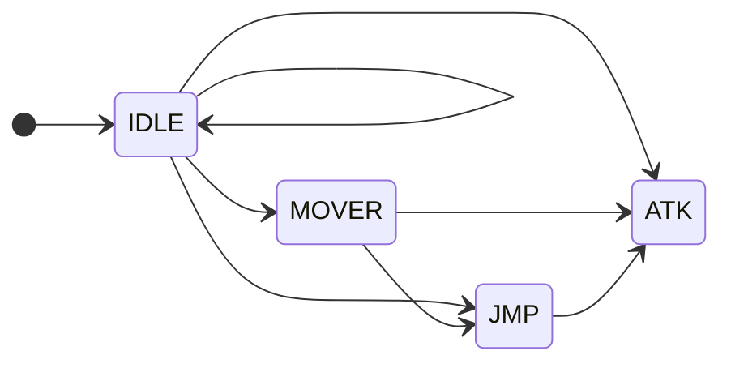
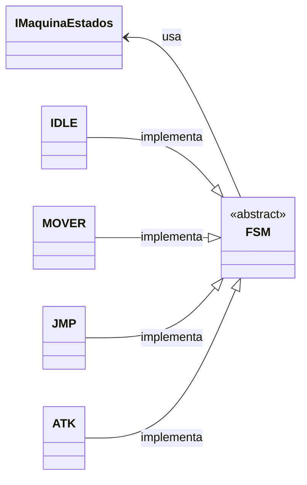
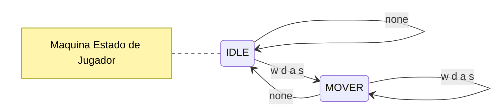
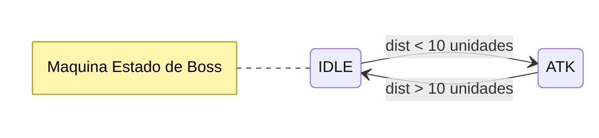

# Laboratorio 8 $\rightarrow$ Animaciones

# Assets

Para esta practica usaremos los siguientes `sprite sheets`

**guardarlo en assets/sprites/naves/**

Este sprite es de 64x64 por lo que la hoja mide 320x64 pixeles

* contiene una animación, se puede usar para el estado mover y idle


**guardarlo en assets/sprites/bosses/**

Este esprite es de 154x130 por lo que la hoja mide 924x260 pixeles

* contiene dos animaciones
* estado idle
* estado ataque


# Animaciones

Las animaciones las haremos con el patrón de maquina de estado, idea es que nuestros entidades tengan un estado y este este relacionado **con la animación y con la acción que esta realizando**



**En clase entidad**  debemos agregar un componente del tipo **IVJ::IMaquinaEstado**, este componente actua como un decorador para toda la maquina de estado, *contiene un atributo* **fsm** el cual **representa un nodo dentro de la maquina de estados**.


**Componente IVJ::IMaquinaEstado**

```cpp
    class IMaquinaEstado : public CE::IComponentes
    {
        public:
            explicit IMaquinaEstado();
            ~IMaquinaEstado() override{};
        public:
            std::shared_ptr<FSM> fsm;
    };
```

**La clase FSM** se encuentra en `Juego/Maquinas/FSM.hpp` representa un nodo dentro de la maquina de estados, por lo que es **una clase abstracta** si queremos crear nuevos nodos es necesario crear nuevos hijos de esta clase.



**La clase FSM** tiene métodos para controlar  que sucede con el nodo

* **onInputs(const IControl&)**: lee la entrada del nodo (necesario para cambiar de nodo o quedarse)
* **onEntrar(const Entidad&)**: que sucede cuando entramos a un nodo (por lo general inicializar variables)
* **onSalir(const Entidad&)**: que sucede cuando salimos del nodo (por lo general limpiamos memoria/variables)
* **onUpdate(const Entidad&, float)**: que sucede mientras estoy en el nodo

```cpp
namespace IVJ
{
    class Entidad; //referencia circular
    class FSM
    {
        public:
            virtual ~FSM()=default;
            virtual FSM* onInputs(const CE::IControl& control)=0;
            virtual void onEntrar(const Entidad& obj)=0;
            virtual void onSalir(const Entidad& obj)=0;
            virtual void onUpdate(const Entidad& obj,float dt)=0;
        protected:
            std::string nombre;
    };
}
```
# RECOMENDACIÓN AL CREAR NODOS Y ANIMACIONES

La idea es que se **reutilicen los nodos** para la mayoria de las entidades (jugador, enemigo1, enemigox, bosses, etc), que quiere decir esto?, **si creamos un nodo de IDLE para jugadorer, que sirva para todos las entidades jugables**, o si hacemos nodos para ataque1, ataque2, ataque3, especial1 , etc para un boss, que sirva para todos los bosses.

Como logro eso?, **Eso se logra teniendo lo siguiente en cuenta:**

* Los sprites deben ser de las mismas dimensiones por ejemplo
    * jugadores : 64x64
    * enemigos : 32x32
    * bosses : 128*254
* La cantidad de frames por animación deben ser iguales por ejemplo:
    * idle : 6 frames para todos
    * mover: 10 frames para todos
* El onInputs debe ser homogenos para todos los que usen ese nodo
    * jugador: usa el control para cambiar de estado 
    * enemigo: podría usar distancias al jugador, o área de escaneo, o tiempo etc
    * bosses: porcentaje de hp, distancia al jugador, reglas/estrategias de la pelea 

Si mantenemos todo homogeno entre los diferentes tipos de entidades, podemos reutilizar los nodos de la maquina de estado sin la necesidad de crear miles, ya que se ocupa 1 por cada animación/acción que se quiera hacer con la entidad.

# Escena animación

Para este laboratorio utilizaremos la escena que hicimos en el laboratorio 7, ya que solamente le vamos agregar cosas a los objetos.

# Animaciones Player

Para las animaciones del jugador, en este caso serán 2, por lo que necesitamos crear dos nodos

* **estado IdleJugadores**: para la nave será el último sprite de la hoja de sprite
* **estado MoverJugadores**: para la nave será los primeros 4 sprites

## FSM IdleJugadores

Este nodo de la maquina, se encargará en posicionar el rectángulo que se muestra en pantalla en la posición donde se encuentra el último sprite.

Creamos la clase en `Juego/Maquinas/Naves/IdleJugadores.hpp y .cpp`

**Recuerda que al crear un nuevo folder hay que agregar el CMakeLists.txt que diga como cargar los nuevos archivos**

En este caso no se nos olvide copiar el CMakeLists.txt de `Motor/GUI` al folder de **Naves** y en el **Juego/Maquinas/CMakeLists.txt** hay que agregar que se adjunte el directorio de naves.

**Juego/Maquinas/CMakeLists.txt**
```cmake
project(CimaEngine3v)
#todos los archivos agregados
file(GLOB_RECURSE gl_cpp RELATIVE ${CMAKE_CURRENT_SOURCE_DIR} "${CMAKE_CURRENT_SOURCE_DIR}/*.cpp")
target_sources(CimaEngine3v PRIVATE ${gl_cpp})

#agregar el directorio donde esta los fsm de las naves
add_subdirectory(Naves)
#hacer ^ lo mismo con los folders de enemigos y bosses más adelante 
```
**Juego/Maquinas/Naves/IdleJugadores.hpp**

Como el idle en la hoja simplemente es 1 sprite, no es necesario calcular el frame rate de la animación, solo pondremos el rectángulo en el frame correspondiente. Por lo que nos queda muy sencillo la clase.

```cpp
#pragma once
#include "../FSM.hpp"
namespace IVJ
{
    class IdleJugadores : public FSM
    {
        public:
            //como solo sera 1 frame, no es necesario
            //llevar control de máximos frames y framerate
            IdleJugadores();
            ~IdleJugadores() override{};
            FSM* onInputs(const CE::IControl& control)override;
            void onEntrar(const Entidad& obj)override;
            void onSalir(const Entidad& obj)override;
            void onUpdate(const Entidad& obj,float dt)override;
        private:
            sf::Sprite *sprite;
            int s_w;
            int s_h;
    };
}
```

**Juego/Maquinas/Naves/IdleJugadores.cpp**

la clase **MoverJugadores** la haremos después de esta, por lo que marcará error.
```cpp
#include "IdleJugadores.hpp"
#include "MoverJugadores.hpp"

namespace IVJ
{
    IdleJugadores::IdleJugadores()
        :FSM{},sprite{nullptr},s_w{0},s_h{0}
    {
        nombre = "IdleJugador";
    }
    FSM* IdleJugadores::onInputs(const CE::IControl& control)
    {
        //si presionamos cualquier dirección cambiarnos
        //al nodo de MoverJugadores(frames,frame_rate)
        if(control.arr || control.abj || control.der ||control.izq)
            return new MoverJugadores(4,0.1f);
        return nullptr;
    }
    void IdleJugadores::onEntrar(const Entidad& obj)
    {
        sprite = &obj.getComponente<CE::ISprite>()->m_sprite;
        s_w = obj.getComponente<CE::ISprite>()->width;
        s_h = obj.getComponente<CE::ISprite>()->height;
    }
    void IdleJugadores::onSalir(const Entidad& obj)
    {
        (void)obj;
    }
    void IdleJugadores::onUpdate(const Entidad& obj,float dt)
    {
        (void)obj;(void)dt;
        sprite->setTextureRect(
                sf::IntRect{
                    {//posicion frame 4 al de idle
                        s_w*4,0
                    },
                    {//tamaño
                        s_w,s_h
                    }
                });
    }
}
```

# FSM MoverJugadores
Este nodo se encargará de correr la animación de que el motor esta encendido, al momento de movernos (presionar cualquier tecla de movimiento) y al momento de ya no presionar nada de movimiento que nos regrese al estado de **IDLE**, en esta clase es necesario llevar un control de los `frames maximos, frame rate` para poder crear una animación fluida.

**Juego/Maquinas/Naves/MoverJugadores.hpp**

```cpp
#pragma once
#include "../FSM.hpp"
namespace IVJ
{
    class MoverJugadores : public FSM
    {
        public:
            MoverJugadores(int max_frames,float frame_rate);
            ~MoverJugadores() override{};
            FSM* onInputs(const CE::IControl& control)override;
            void onEntrar(const Entidad& obj)override;
            void onSalir(const Entidad& obj)override;
            void onUpdate(const Entidad& obj,float dt)override;
        private:
            sf::Sprite *sprite; //referencia al sprite 
            int s_w;            //sprite width
            int s_h;            //sprite height
            float max_tiempo;   //frame rate
            float act_tiempo;   //frame rate actual
            int max_frames;     //frames de animación
            int id_frame;       //frame actual de animación
    };
}
```

**Juego/Maquinas/Naves/MoverJugadores.cpp**

La forma que vamos a llevar el framerate de la animación es dandole un tiempo ´máximo en segundos por frame, por ejemplo si 60 frames es 1 segundo, quiero que cada frame de mi animación se ejecute en 0.25 segundos, en este caso 4 frames de animación se ejecutan en 1seg, todo este mecanismo lo haremos en la función onUpdate

```cpp
#include "MoverJugadores.hpp"
#include "IdleJugadores.hpp"
namespace IVJ
{
    MoverJugadores::MoverJugadores(int max_frames,float frame_rate)
        :FSM{},sprite{nullptr},s_w{0},s_h{0},
        max_tiempo{frame_rate},
        act_tiempo{frame_rate},
        max_frames{max_frames}
    {
        nombre = "MoverJugador";
    }
    FSM* MoverJugadores::onInputs(const CE::IControl& control)
    {
        //si nada esta presionado regresar a idle
        if(!control.arr && !control.abj && !control.der && !control.izq)
            return new IdleJugadores();

        return nullptr;
    }
    void MoverJugadores::onEntrar(const Entidad& obj)
    {
        sprite = &obj.getComponente<CE::ISprite>()->m_sprite;
        s_w = obj.getComponente<CE::ISprite>()->width;
        s_h = obj.getComponente<CE::ISprite>()->height;
        id_frame=0;
    }
    void MoverJugadores::onSalir(const Entidad& obj)
    {
        (void)obj;
    }
    void MoverJugadores::onUpdate(const Entidad& obj,float dt)
    {
        (void)obj; //quitar el warning de no usar obj
        act_tiempo = act_tiempo - dt;
        //frame rate
        if (act_tiempo <=0)
        {
            //frame mostrando
            sprite->setTextureRect(
                    sf::IntRect{
                        {//posicion id*width = frame actual
                            s_w*(id_frame%max_frames),0
                        },
                        {//tamaño
                            s_w,s_h
                        }
                    });
            id_frame++;
            act_tiempo=max_tiempo;
        }
    }
}
```

# Escena Animación

Para la escena hay muy pocas modificaciones:

* Vamos a cargar la hoja de sprite de la nave
* Vamos a cambiar la textura del sprite a que sea la hoja
* Agregaremos un componente de Maquina de estado a jugador
* Agregaremos un nodo de IDLE a la maquina al iniciar
* Ejecutamos los inputs del FSM antes del update de jugador

Con esos cambios a jugador podremos tener las animaciones correspondientes

**Juego/Escenas/Escena_LAB7.cpp**

```cpp
    void Escena_Sprite::onInit()
    {
        CE::GestorCamaras::Get().setCamaraActiva(2);
        CE::GestorCamaras::Get().getCamaraActiva().lockEnObjeto(player);
        if(!inicializar) return;
        registrarBotones(sf::Keyboard::Scancode::W,"arriba");
        registrarBotones(sf::Keyboard::Scancode::Up,"arriba");
        registrarBotones(sf::Keyboard::Scancode::S,"abajo");
        registrarBotones(sf::Keyboard::Scancode::Down,"abajo");
        registrarBotones(sf::Keyboard::Scancode::A,"izquierda");
        registrarBotones(sf::Keyboard::Scancode::Left,"izquierda");
        registrarBotones(sf::Keyboard::Scancode::D,"derecha");
        registrarBotones(sf::Keyboard::Scancode::Right,"derecha");
        registrarBotones(sf::Keyboard::Scancode::Enter,"aceptar");

        //cargar mapa
        tiles_layers.push_back(TileMap());
        tiles_layers.push_back(TileMap());
        tiles_layers.push_back(TileMap());

        if(!tiles_layers[0].loadTileMap(ASSETS "/mapas/playa_layer1.txt"))
            exit(EXIT_FAILURE);
        if(!tiles_layers[1].loadTileMap(ASSETS "/mapas/playa_layer2.txt"))
            exit(EXIT_FAILURE);
        if(!tiles_layers[2].loadTileMap(ASSETS "/mapas/playa_layer3.txt"))
            exit(EXIT_FAILURE);

        //Lab 8 animacinoes
        CE::GestorAssets::Get().agregarTextura(
                "nave_sheet",                               //key
                ASSETS "/sprites/naves/player_sheet.png",   //hoja
                CE::Vector2D{0.f,0.f},                      //inicio
                CE::Vector2D{320.f,64.f}                    //dim de la hoja
            );

        auto trans = player->getTransformada();
        trans->velocidad = CE::Vector2D{500.f,500.f};
        player->setPosicion(300.f,300.f);
        
        //Lab 8 animaciones
        auto sprite = std::make_shared<CE::ISprite>(
                CE::GestorAssets::Get().getTextura("nave_sheet"), //textura
                64,64,                                      // dim
                1.f);                                       // escala
        
        player->addComponente(sprite);
        player->addComponente(std::make_shared<CE::IControl>());
        
        //lab 8 animaciones
        auto me = std::make_shared<IMaquinaEstado>();
        me->fsm = std::make_shared<IdleJugadores>();
        player->addComponente(me);
        //ejecuta onEntrar para inicializar variables
        player->setFSM(me->fsm);

        inicializar=false;
    }

    void Escena_Sprite::onUpdate(float dt)
    {
        player->inputFSM(); //ejecutar los inputs de la maquina
        player->onUpdate(dt); //aquí se actualiza la maquina  (<Entidad>)
        SistemaMover(player,dt);
        for(auto& obj: objetos.getPool())
        {
            obj->onUpdate(dt);
        }
    }
```

Lo que acabamos de hacer fue lo siguiente




Si compilamos y ejecutamos tenemos la siguientes animaciones.


**IDLE**


**MOVER**


# Bosses

Para los enemigos me gustaria que siguieran al jugador (no de moverse si no de acecho), por lo que se va necesitar crear lo siguiente (antes de animar):

* Un componente de Rango llamado IRangoAggro, si el jugador esta dentro de este rango entonces lo acecha.
* Un Sistema para que el npc pueda acechar llamado SistemaNPCLookTarget, esto nos va ayudar a que el sprite este en la dirección correcta, pero solo si esta dentro del rango el jugador.

**Juego/Componentes/IJComponetes.hpp y cpp**

Para el componente de rango solo ocupamos el radio del rango y un círculo que marque el área de activación, para este caso vamos a romper el modelo ECS puro y vamos agregar una función a nuestro componente ( ya que tiene sentido que el componente revise si algún punto esta dentro de el rango)

Ocupamos un componente Target para más adelante usarlo en otros sistemas como la maquina de estados.

```cpp
    class ITarget : public CE::IComponentes
    {
        public:
            //puede ser nula por eso *
            explicit ITarget(CE::Objeto * target);
            void setTarget(CE::Objeto& t);
        public:
            CE::Vector2D* pos;
    };
    class IRangoAggro : public CE::IComponentes
    {
        public:
            explicit IRangoAggro(float radio);
            virtual ~IRangoAggro(){};
            bool estaDentroRango(CE::Objeto parent, CE::Vector2D& target);
        public:
            float radio;
            sf::CircleShape marcador;
    };
```
**.CPP**

Para calcular si un punto esta dentro de un círculo se calcula la distancia del punto con el centro del círculo, si es menor al radio al cuadrado entonces esta dentro.

$$(x-cx)^2 + (y-cy)^2 \leq r^2$$

```cpp
    ITarget::ITarget(CE::Objeto *target)
        :CE::IComponentes{},pos{nullptr}
    {
        if(target)
            pos = &target->getTransformada()->posicion;
    }
                                    //& garantiza que no sea nulo
    void ITarget::setTarget(CE::Objeto& t)
    {
        pos = &(t.getTransformada()->posicion);
    }

    IRangoAggro::IRangoAggro(float radio)
        :CE::IComponentes{},radio{radio},
        marcador{sf::CircleShape{radio}}        
    {
        marcador.setOrigin({radio,radio});
        marcador.setFillColor(sf::Color{255,0,0,128});
    }
    bool IRangoAggro::estaDentroRango(CE::Objeto& parent,CE::Vector2D& target)
    {
        auto pos = parent.getTransformada()->posicion;
        
        //asumiendo la formula del circulo x^2+y^2 =r^2
        //si quiero saber si un punto esta dentro del circulo entonces
        //el centro en (h,k) podemos calcular la distancia del punto(x,y)
        //con respecto al centro y el radio.
        //(x-h)^2 + (y-k)^2 <= r^2
        //punto es el target y centro la pos del ente 
        float r2 = radio*radio;
        float diX = (target.x-pos.x);
        float diY = (target.y-pos.y);
        float dist = diX*diX + diY*diY;

        return dist <= r2;
    }
```

**Juego/Sistemas/Sistemas.hpp y cpp**

Vamos a crear nuestro sistempa para que un NPC este volteando y acechando a nuestro jugador si el jugador para por un área de activación

**hpp**

```cpp
[[maybe_unused]] void SistemaNPCLookTarget(CE::Objeto &ente, CE::Vector2D& target);

```

**cpp**
```cpp
    void SistemaNPCLookTarget(CE::Objeto &ente, CE::Vector2D& target)
    {
        if(!ente.tieneComponente<IRangoAggro>()) return;
        
        auto rango = ente.getComponente<IRangoAggro>();
        if (!rango->estaDentroRango(ente,target)) return;

        auto pos = ente.getTransformada()->posicion;
        auto ente_a_target =  target-pos;
        ente.getTransformada()->angulo = atan2(
                ente_a_target.y,
                ente_a_target.x
            );
        //reflejar imagen
        if (ente_a_target.x <0)
            ente.getComponente<CE::ISprite>()->m_sprite.setScale({1,-1});
        else
            ente.getComponente<CE::ISprite>()->m_sprite.setScale({1,1});
    }

```

Vamos a probar el sistema que acabamos de realizar, así mismo cargamos el sprite_sheet para este NPC que actua como "jefe"

**Juego/Escenas/Escena_Lab7.cpp**

**CPP**

```cpp
    void Escena_Sprite::onInit()
    {
        CE::GestorCamaras::Get().setCamaraActiva(2);
        CE::GestorCamaras::Get().getCamaraActiva().lockEnObjeto(player);
        if(!inicializar) return;
        registrarBotones(sf::Keyboard::Scancode::W,"arriba");
        registrarBotones(sf::Keyboard::Scancode::Up,"arriba");
        registrarBotones(sf::Keyboard::Scancode::S,"abajo");
        registrarBotones(sf::Keyboard::Scancode::Down,"abajo");
        registrarBotones(sf::Keyboard::Scancode::A,"izquierda");
        registrarBotones(sf::Keyboard::Scancode::Left,"izquierda");
        registrarBotones(sf::Keyboard::Scancode::D,"derecha");
        registrarBotones(sf::Keyboard::Scancode::Right,"derecha");
        registrarBotones(sf::Keyboard::Scancode::Enter,"aceptar");

        //cargar mapa
        tiles_layers.push_back(TileMap());
        tiles_layers.push_back(TileMap());
        tiles_layers.push_back(TileMap());

        if(!tiles_layers[0].loadTileMap(ASSETS "/mapas/playa_layer1.txt"))
            exit(EXIT_FAILURE);
        if(!tiles_layers[1].loadTileMap(ASSETS "/mapas/playa_layer2.txt"))
            exit(EXIT_FAILURE);
        if(!tiles_layers[2].loadTileMap(ASSETS "/mapas/playa_layer3.txt"))
            exit(EXIT_FAILURE);

        //Lab 8 animacinoes
        CE::GestorAssets::Get().agregarTextura(
                "nave_sheet",                               //key
                ASSETS "/sprites/naves/player_sheet.png",   //hoja
                CE::Vector2D{0.f,0.f},                      //inicio
                CE::Vector2D{320.f,64.f}                    //dim de la hoja
            );

        CE::GestorAssets::Get().agregarTextura(
                "boss_sheet",
                ASSETS "/sprites/bosses/VileCrustaceanIdleAttack.png",
                CE::Vector2D{0.f,0.f},
                CE::Vector2D{924.f,260.f}
            );

        auto trans = player->getTransformada();
        trans->velocidad = CE::Vector2D{500.f,500.f};
        player->setPosicion(300.f,300.f);
        
        //Lab 8 animaciones
        auto sprite = std::make_shared<CE::ISprite>(
                CE::GestorAssets::Get().getTextura("nave_sheet"), //textura
                64,64,                                      // dim
                1.f);                                       // escala
        
        player->addComponente(sprite);
        player->addComponente(std::make_shared<CE::IControl>());
        
        //lab 8 animaciones
        auto me = std::make_shared<IMaquinaEstado>();
        me->fsm = std::make_shared<IdleJugadores>();
        player->addComponente(me);
        //ejecuta onEntrar para inicializar variables
        player->setFSM(me->fsm);
        

        //boss entidad
        auto boss = std::make_shared<Entidad>();
        auto boss_sprite = std::make_shared<CE::ISprite>(
                CE::GestorAssets::Get().getTextura("boss_sheet"),
                154.f,130.f,
                1.f);
        //Por el momento no tiene estados, esta vacia la maquina
        auto boss_me = std::make_shared<IVJ::IMaquinaEstado>();
        auto boss_target = std::make_shared<ITarget>(nullptr);
        boss_target->setTarget(*player);
        
        boss->addComponente(boss_sprite)
            .addComponente(boss_me)
            .addComponente(std::make_shared<IRangoAggro>(500.f))
            .addComponente(boss_target)
            .setPosicion(500.f,500.f);

        objetos.agregarPool(boss);

        inicializar=false;
    }
    void Escena_Sprite::onUpdate(float dt)
    {
        player->inputFSM();
        player->onUpdate(dt);
        SistemaMover(player,dt);
        for(auto& obj: objetos.getPool())
        {
            obj->onUpdate(dt);
            if(obj->tieneComponente<ITarget>())
            {
                auto& tpos = *obj->getComponente<ITarget>()->pos;
                SistemaNPCLookTarget(*obj,tpos);
            }
        }
    }
```

En el OnRender agregamos que se muestre el circulo del rango

```cpp
    void Escena_Sprite::onRender()
    {
        for(auto& al: tiles_layers)
            CE::Render::Get().AddToDraw(al);

        for(auto& obj: objetos.getPool())
        {   
            //Lab 8 animaciones
            if(obj->tieneComponente<IRangoAggro>())
            {
                auto rango  = obj->getComponente<IRangoAggro>();
                auto pos = obj->getTransformada()->posicion;
                rango->marcador.setPosition({pos.x,pos.y});
                CE::Render::Get().AddToDraw(rango->marcador);
            }

            CE::Render::Get().AddToDraw(*obj);
        }
        CE::Render::Get().AddToDraw(*player);

#if DEBUG
        auto cam = &CE::GestorCamaras::Get().getCamaraActiva();
        auto csv = (CE::CamaraSnapVentana*)cam;
        auto csvpos = csv->getTransformada().posicion;
        sf::RectangleShape debugcam{{csv->m_vdim.x,csv->m_vdim.y}};
        debugcam.setOrigin({csv->m_vdim.x/2.f,csv->m_vdim.y/2.f});
        debugcam.setPosition({csvpos.x,csvpos.y});
        debugcam.setOutlineThickness(3.f);
        debugcam.setOutlineColor(sf::Color::Yellow);
        debugcam.setFillColor(sf::Color::Transparent);
        CE::Render::Get().AddToDraw(debugcam);
#endif
    }
```

Si compilamos tendremos lo siguiente:

**Fuera del área no se actualiza la dirección del NPC**


**Dentro del área se actualiza la dirección del NPC**


Esta entidad será un poco más grande y servirá de ejemplo de como cargar varias animaciones en una sola hoja

Para esta maquina haremos



Como este Jefe sus inputs son diferentes a los de un Jugador, vamos a crear su propia clase, heredando de la principal pero agregando un método diferente para los inputs, en este caso, le pasaremos el jugador (Entidad) y así mismo (Entidad)

**Juego/Maquinas/FSMBoss.hpp**

```cpp
#pragma once
#include "../FSM.hpp"
namespace IVJ
{
    class FSMBoss : public FSM
    {
        public:
            virtual ~FSMBoss()=default;
            //a boss no le interesa este tipo de inputs por eso vacio
            //(mal diseño pero para no romper entidad)
            //(para este tipo de problemas aplicar patron de:
            //puente, facade, estrategia, comando, adaptador )
            virtual FSM* onInputs(const CE::IControl& control) override
            {(void)control;return nullptr;};
            //el input que usaremos
            virtual FSM* onInputs(Entidad& parent, CE::Vector2D& target)=0;
            virtual void onEntrar(const Entidad& obj) override=0;
            virtual void onSalir(const Entidad& obj) override=0;
            void onUpdate(const Entidad& obj,float dt) override =0;
    };
}
```


**Juego/Maquinas/Bosses/IdleBoss.hpp y cpp**

```cpp
#pragma once
#include "FSMBoss.hpp"

namespace IVJ
{
    class IdleBoss : public FSMBoss
    {
        public:
            explicit IdleBoss(int max_frames, float frame_rate);
            FSM* onInputs(Entidad& parent, CE::Vector2D& target)override;
            void onEntrar(const Entidad& obj) override;
            void onSalir(const Entidad& obj) override;
            void onUpdate(const Entidad& obj,float dt) override ;
        private:
            int max_frames;
            int id_frame;
            float max_frame_time;
            float cur_frame_time;
            int t_w;
            int t_h;
    };
}
```

**CPP**

```cpp
#include "IdleBoss.hpp"
#include "Motor/Componentes/IComponentes.hpp"

namespace IVJ
{

    IdleBoss::IdleBoss(int max_frames, float frame_rate)
        :FSMBoss{},
        max_frames{max_frames},
        id_frame{0},
        max_frame_time{frame_rate},
        cur_frame_time{frame_rate}
    {
        //muy importante el nombre es el que vamos utilizar para nuestro facade
        nombre = "IdleBoss";
    }
    FSM* IdleBoss::onInputs(Entidad& parent, CE::Vector2D& target)
    {
        (void)parent;(void)target;
        auto pos = parent.getTransformada()->posicion;
        float distancia = pos.distancia(target);
        if(distancia <200.f)
            std::cout<<"Cambiar Animación\n";
        return nullptr;
    }
    void IdleBoss::onEntrar(const Entidad& obj)
    {
        auto sprite = obj.getComponente<CE::ISprite>();
        t_w = sprite->width;
        t_h = sprite->height;
    }
    void IdleBoss::onSalir(const Entidad& obj)
    {
        (void)obj;
    }
    void IdleBoss::onUpdate(const Entidad& obj,float dt)
    {
        cur_frame_time -= dt;

        if (cur_frame_time <=0)
        {
            obj.getComponente<CE::ISprite>()->m_sprite.setTextureRect(
                    sf::IntRect(
                        {//pos
                            t_w*(id_frame%max_frames),
                            0*t_h //primer renglon
                        },
                        {//dimensinones
                            t_w,
                            t_h
                        }
                        )
                    );
            cur_frame_time = max_frame_time;
            id_frame++;
        }
    }
}
```

## PATCH DE ARQUITECTURA

debido a que cuando se planeo el motor aún no tenía maquinas de estado, no se agrego esas funciones a CE::Objeto, por lo que tendriamos que castiar y truncar bytes en los objetos y no queremos eso, lo que queremos es aprobechar el polimorfismo.

Para esto vamos a aplicar un pequeño patch en `Motor/Primitivos/Objetos.hpp`

**Motor/Primitivos/Objetos.hpp**

simplemente agregamos una función virtual con implementación vacia para no romper las otras escenas.

```cpp
namespace CE
{
    class Objeto: public sf::Drawable, public sf::Transformable
    {
        public:
            explicit Objeto();
            virtual ~Objeto() = default;
            //PATCH
            virtual void inputFSM(){};
```

**Juego/objetos/Entidad.hpp y CPP**

Esto conlleva que la firma de inputFSM cambie en Entidad.

Practicamente tenemos que agregar una nueva función que nos permita ejecutar los inputs de la maquina de estados del boss (aquí sería bueno aplicar el patrón fabrica o facade o adaptador o patrón estrategia), **PeRO** solamente aplicaremos un pseudo facade en la función de inputFSM de Entidad y usaremos el atributo nombre para usar el nodo correcto) **(es necesario hacer publico el nombre de FSM o hacer un getter)**

**HPP**

```cpp
#pragma once
#include "../../Motor/Primitivos/Objetos.hpp" 
#include "../Maquinas/FSM.hpp"
#include <memory>

namespace IVJ
{
    class FSM; //referencia circular
    class Entidad: public CE::Objeto
    {
        public:
            void onUpdate(float dt) override;
            void draw(sf::RenderTarget &target, sf::RenderStates state) const override;

            //fsm
            void setFSM(const std::shared_ptr<FSM>& mq);
            //patch
            void inputFSM() override;
    };
}
```

**CPP**

```cpp
    void Entidad::inputFSM()
    {
        if(!getComponente<IMaquinaEstado>() 
        || !getComponente<IMaquinaEstado>()->fsm)
            return;
        auto mq = getComponente<IMaquinaEstado>();
        //Lab 8 Animaciones: Pequeño facade usando el nombre del nodo
        if(mq->fsm->getNombre().find("Boss")!=std::string::npos)
        {
            auto target = getComponente<ITarget>()->pos;
            //usar el nodo correcto de boss
            auto n_estado = std::static_pointer_cast<FSMBoss>(mq->fsm)->onInputs(*this,*target);
            std::shared_ptr<FSM> estado(n_estado);
            if(estado)
                setFSM(estado);
        }else
        {
            if(!getComponente<CE::IControl>())  return;
            auto control = *getComponente<CE::IControl>();
            auto n_estado = mq->fsm->onInputs(control);
            std::shared_ptr<FSM> estado(n_estado);
            if(estado)
                setFSM(estado);
        }
    }
```


## TEST PATCH

para probar los cambios, vamos a nuestra escena y agregamos un nodo de IdleBoss al "jefe", en update actualizamos los inputs y compilamos

```cpp
    void Escena_Sprite::onInit()
    {
        CE::GestorCamaras::Get().setCamaraActiva(2);
        CE::GestorCamaras::Get().getCamaraActiva().lockEnObjeto(player);
        if(!inicializar) return;
        registrarBotones(sf::Keyboard::Scancode::W,"arriba");
        registrarBotones(sf::Keyboard::Scancode::Up,"arriba");
        registrarBotones(sf::Keyboard::Scancode::S,"abajo");
        registrarBotones(sf::Keyboard::Scancode::Down,"abajo");
        registrarBotones(sf::Keyboard::Scancode::A,"izquierda");
        registrarBotones(sf::Keyboard::Scancode::Left,"izquierda");
        registrarBotones(sf::Keyboard::Scancode::D,"derecha");
        registrarBotones(sf::Keyboard::Scancode::Right,"derecha");
        registrarBotones(sf::Keyboard::Scancode::Enter,"aceptar");

        //cargar mapa
        tiles_layers.push_back(TileMap());
        tiles_layers.push_back(TileMap());
        tiles_layers.push_back(TileMap());

        if(!tiles_layers[0].loadTileMap(ASSETS "/mapas/playa_layer1.txt"))
            exit(EXIT_FAILURE);
        if(!tiles_layers[1].loadTileMap(ASSETS "/mapas/playa_layer2.txt"))
            exit(EXIT_FAILURE);
        if(!tiles_layers[2].loadTileMap(ASSETS "/mapas/playa_layer3.txt"))
            exit(EXIT_FAILURE);

        //Lab 8 animacinoes
        CE::GestorAssets::Get().agregarTextura(
                "nave_sheet",                               //key
                ASSETS "/sprites/naves/player_sheet.png",   //hoja
                CE::Vector2D{0.f,0.f},                      //inicio
                CE::Vector2D{320.f,64.f}                    //dim de la hoja
            );

        CE::GestorAssets::Get().agregarTextura(
                "boss_sheet",
                ASSETS "/sprites/bosses/VileCrustaceanIdleAttack.png",
                CE::Vector2D{0.f,0.f},
                CE::Vector2D{924.f,260.f}
            );

        auto trans = player->getTransformada();
        trans->velocidad = CE::Vector2D{500.f,500.f};
        player->setPosicion(300.f,300.f);
        
        //Lab 8 animaciones
        auto sprite = std::make_shared<CE::ISprite>(
                CE::GestorAssets::Get().getTextura("nave_sheet"), //textura
                64,64,                                      // dim
                1.f);                                       // escala
        
        player->addComponente(sprite);
        player->addComponente(std::make_shared<CE::IControl>());
        
        //lab 8 animaciones
        auto me = std::make_shared<IMaquinaEstado>();
        me->fsm = std::make_shared<IdleJugadores>();
        player->addComponente(me);
        //ejecuta onEntrar para inicializar variables
        player->setFSM(me->fsm);
        

        //boss entidad
        auto boss = std::make_shared<Entidad>();
        auto boss_sprite = std::make_shared<CE::ISprite>(
                CE::GestorAssets::Get().getTextura("boss_sheet"),
                154.f,130.f,
                1.f);
        auto boss_me = std::make_shared<IVJ::IMaquinaEstado>();
        //probar patch con nodo IdleBoss
        boss_me->fsm = std::make_shared<IVJ::IdleBoss>(6,0.25f);
        auto boss_target = std::make_shared<ITarget>(nullptr);
        boss_target->setTarget(*player);
        
        boss->addComponente(boss_sprite)
            .addComponente(boss_me)
            .addComponente(std::make_shared<IRangoAggro>(500.f))
            .addComponente(boss_target)
            .setPosicion(500.f,500.f);
        boss->setFSM(boss_me->fsm);

        objetos.agregarPool(boss);

        inicializar=false;
 
    void Escena_Sprite::onUpdate(float dt)
    {
        player->inputFSM();
        player->onUpdate(dt);
        SistemaMover(player,dt);
        for(auto& obj: objetos.getPool())
        {
            obj->inputFSM();
            obj->onUpdate(dt);
            if(obj->tieneComponente<ITarget>())
            {
                auto& tpos = *obj->getComponente<ITarget>()->pos;
                SistemaNPCLookTarget(*obj,tpos);
            }
        }
    }
```

al compilar nos tiene que dar lo siguiente:

**Lejos del jefe**


**Cerca del jefe***


Con esto probamos que ya podemos agregar nodos que no deriven directamente de FSM, solo agregamos un facade a la función de inputFSM de entidad, por lo que si quisieramos agregar otro tipo de nodo, solo continuamos con el mismo patrón.

## Nodo AttackBoss


**Juego/Maquinas/Bosses/AtackBoss.hpp y cpp**

**HPP**

```cpp
#pragma once
#include "FSMBoss.hpp"
#include "Motor/Utils/Vector2D.hpp"
namespace IVJ
{
    class AttackBoss : public FSMBoss
    {
        public:
            explicit AttackBoss(int max_frames, float frame_rate);
            FSM* onInputs(Entidad& parent, CE::Vector2D& target)override;
            void onEntrar(const Entidad& obj) override;
            void onSalir(const Entidad& obj) override;
            void onUpdate(const Entidad& obj,float dt) override ;
        private:
            int max_frames;
            int id_frame;
            float max_frame_time;
            float cur_frame_time;
            int t_w;
            int t_h;
    };
}
```

**CPP**

```cpp
#include "AttackBoss.hpp"
#include "IdleBoss.hpp"
#include "Motor/Componentes/IComponentes.hpp"
#include "Motor/Utils/Vector2D.hpp"

namespace IVJ
{

    AttackBoss::AttackBoss(int max_frames, float frame_rate)
        :FSMBoss{},
        max_frames{max_frames},
        id_frame{0},
        max_frame_time{frame_rate},
        cur_frame_time{frame_rate}
    {
        //muy importante el nombre es el que vamos utilizar para nuestro facade
        nombre = "AttackBoss";
    }
    FSM* AttackBoss::onInputs(Entidad& parent, CE::Vector2D& target)
    {
        auto pos = parent.getTransformada()->posicion;
        float distancia = pos.distancia(target);
        //muy lejos para atacar
        if(distancia >200.f)
            return new IdleBoss(6,0.25f);
        return nullptr;
    }
    void AttackBoss::onEntrar(const Entidad& obj)
    {
        auto sprite = obj.getComponente<CE::ISprite>();
        t_w = sprite->width;
        t_h = sprite->height;
    }
    void AttackBoss::onSalir(const Entidad& obj)
    {
        (void)obj;
        //se usará después con sonidos
    }
    void AttackBoss::onUpdate(const Entidad& obj,float dt)
    {
        cur_frame_time -= dt;

        if (cur_frame_time <=0)
        {
            obj.getComponente<CE::ISprite>()->m_sprite.setTextureRect(
                    sf::IntRect(
                         {//pos
                          t_w*(id_frame%max_frames),
                          1*t_h //segundo renglón
                         },
                         {//dimensinones
                            t_w,
                            t_h
                         }
                    )
            );
            cur_frame_time = max_frame_time;
            id_frame++;
        }
    }
}
```

En realidad si todas las animaciones estan en una sola hoja, podemos solamente crear 1 nodo y pasarle por parámetro en cual renglon o columna se encuentra la animación, en este caso lo separe en dos clases para que se vea el proceso, pero se puede reducir a una clase y le pasamos el renglon


No nos olvidemos de cambiar IdleBoss a que pueda cambiar de nodo, en vez de solamente mostrar el mensaje en consola

**Juego/Maquinas/Boses/IdleBoss.cpp**

```cpp
//#include "AttackBoss.hpp"

    FSM* IdleBoss::onInputs(Entidad& parent, CE::Vector2D& target)
    {
        auto pos = parent.getTransformada()->posicion;
        float distancia = pos.distancia(target);
        if(distancia <200.f)
            return new AttackBoss(6,0.25f);
        return nullptr;
    }
```

si compilamos al acercarnos se cambiará a la animación de ataque


