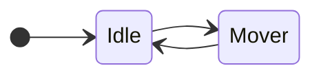

# Laboratorio 10 $\rightarrow$ Shaders
# Shaders
Para esta practica usaremos los siguientes sprites:


y este tambien:


Para este laboratorio vamos a utilizar dos escenas, la primera llamada **Escena_shaders** donde se mostrará como se
utilizan los shaders en el **CimaEngine3v**, y la segunda vamos a continuar la escena del laboratorio pasado en donde
incorporaremos shaders para efectos.

# Escena_shaders

Para esta escena solo servira de prueba, no tiene funcionabilidad, vamos a crear 1 ente hongo y vamos a reutilizar el ente
de personaje, la hoja de sprites de este personaje, no es convencional ya que cada frame tiene diferente tamaño, por lo que
se realizará una maquina de estados **especifica a esta hoja de sprites**

Empecemos por crear la escena en **Juego/Escenas/Escena_shaders.hpp y .cpp**

```cpp
#pragma  once

#include <Motor/Primitivos/Escena.hpp>

namespace  IVJ
{
    class Escena_shaders : public  CE::Escena
    {
    public:
        explicit  Escena_shaders(std::shared_ptr<Entidad>& ref);
        ~Escena_shaders() override{};
        
        void onInit() override;
        void onFinal() override;
        void onUpdate(float dt) override;
        void onInputs(const CE::Botones &accion) override;
        void onRender() override;
    private:
        std::shared_ptr<Entidad>& player;
        bool inicializar{true};
    };
}
```

**y el .cpp**

```cpp
#include "Escena_shaders.h"
#include <Motor/Render/Render.hpp>

namespace  IVJ
{
    Escena_shaders::Escena_shaders(std::shared_ptr<Entidad>& ref)
        :CE::Escena{},player{ref}
    {
    
    }
    
    void Escena_shaders::onInit()
    {
        if (!inicializar)
            return;
        
        inicializar=false;
    }
    
    void Escena_shaders::onFinal()
    {
    
    }
    
    void Escena_shaders::onInputs(const CE::Botones &accion)
    {
        (void)accion;
    }
    
    void Escena_shaders::onUpdate(float dt)
    {
        (void)dt;
    }
    void Escena_shaders::onRender()
    {
        for(auto obj : objetos.getPool())
            CE::Render::Get().AddToDraw(*obj);
    }
    
}
```

**En Juego/Juego.cpp** asignamos la escena y le pasamos como referencia la entidad jugador.


```cpp
//.. más includes arriba, se agrego --v
#include <Juego/Escenas/Escena_shaders.h>
void Juego::OnInit(void)
{
    std::cout << "Inicializando Juego\n";

    // crear el jugador
    jugador = std::make_shared<Entidad>();
    jugador->getStats()->hp_max = 255;
    jugador->getStats()->hp = 255;
    jugador->getStats()->str = 255;
    jugador->getStats()->def = 255;
    jugador->getStats()->agi = 255;

    CE::GestorEscenas::Get().registrarEscena("Init", std::make_shared<Escena_Init>());
    CE::GestorEscenas::Get().registrarEscena("Menu", std::make_shared<Escena_Menu>());
    CE::GestorEscenas::Get().registrarEscena("Sim", std::make_shared<Escena_Sim>());
    //se agrego esta --v
    CE::GestorEscenas::Get().registrarEscena("Shade", std::make_shared<Escena_shaders>(jugador));
    
    CE::GestorEscenas::Get().cambiarEscena("Shade");
    escena_actual = &CE::GestorEscenas::Get().getEscenaActual();
}
```

Con eso **Volvemos hacer el build y recompilamos** para tener una nueva escena vacia

## Animaciones Personaje

En este caso vamos utilizar dos nodos en nuestra maquina de estados



Para esta ocación vamos a crear un folder **llamado yusm** dentro de **Juego/Maquinas/** y dentro de ese folder vamos a
crear un **CMakeLists.txt** con solo el nombre del proyecto y el código para automáticamente cargar los .cpp .

**Juego/Maquinas/yusm/CMakeLists.txt**
```cmake
project(CimaEngine3v)
file(GLOB_RECURSE gl_cpp RELATIVE ${CMAKE_CURRENT_SOURCE_DIR} "${CMAKE_CURRENT_SOURCE_DIR}/*.cpp")
target_sources(CimaEngine3v PRIVATE ${gl_cpp})
```

y en el **Juego/Maquinas/CMakeLists.txt ** agregamos el folder de yusm

```cmake
project(CimaEngine3v)

#todos los archivos agregados
file(GLOB_RECURSE gl_cpp RELATIVE ${CMAKE_CURRENT_SOURCE_DIR} "${CMAKE_CURRENT_SOURCE_DIR}/*.cpp")

target_sources(CimaEngine3v PRIVATE ${gl_cpp})

add_subdirectory(yusm)
```

Con esto cuando volvamos a crear el ensamble, nos debe agregar todos los archvos .cpp dentro del folder yusm

### Nodo EstadoIdleYu
Para este nodo creamos los archivos **Juego/Maquinas/yusm/EstadoIdleYu.hpp y .cpp**, este nodo se encargará de
mostrar la animación idle, cabe recalcar que la hoja de sprite tiene un **padding** en el renglón de IDLE (el 0)
por lo que lo vamos a tomar en cuenta al momento de crear la animación.

**Juego/Maquinas/yusm/EstadoIdleYu.hpp**
Como es un poco irregular los tamaños de los cuadros, por constructor le pasamos las dimensiones, la cantidad de frames
y el frame rate que queremos que avancen los frames.

Tambien tendremos unas referencias al sprite y al shader para poder subir valores al gpu
```cpp
#pragma once
#include <Juego/Maquinas/FSM.hpp>

namespace IVJ
{
    class EstadoIdleYu : public FSM{
    public:
        explicit EstadoIdleYu(const CE::Vector2D & box, int frames,float frame_rate=0.3f);
        ~EstadoIdleYu() override= default;
        FSM* onInputs(const CE::IControl& control) override;
        void onEntrar(const Entidad& obj) override;
        void onSalir(const Entidad& obj) override;
        void onUpdate(const Entidad& obj,float dt) override;
    private:
        CE::Vector2D dim_box;
        sf::Sprite* sprite;
        int frames;
        int id_frame;
        float frame_rate;
        float frame_actual;
        float padding{};
        CE::IShader * shader{};
    };
}
```

**Nota aún no vamos a implementar nada del shader hasta más abajo en la guía**

**Juego/Maquinas/yusm/EstadoIdleYu.cpp**
```cpp
#include "EstadoIdleYu.hpp"
#include <Motor/Render/Render.hpp>

namespace IVJ
{
    EstadoIdleYu::EstadoIdleYu(const CE::Vector2D &box,int frames,float frame_rate)
        :FSM{},dim_box{box},sprite{nullptr},frames{frames},
        id_frame{0},frame_rate{frame_rate},frame_actual{frame_rate}
    {
        nombre = "YU_IDLE";
    }
    
    FSM *EstadoIdleYu::onInputs(const CE::IControl &control) {
        
        //aquí para cambiar de estado a mover dependiendo que presione
        return nullptr;
    }
    
    void EstadoIdleYu::onEntrar(const Entidad &obj) {
        sprite = &obj.getComponente<CE::ISprite>()->m_sprite;
        id_frame=0;
        padding = 5.f;
        if(obj.tieneComponente<CE::IShader>()) {
            shader = obj.getComponente<CE::IShader>();
        else
            shader = nullptr;
    }
    
    void EstadoIdleYu::onSalir(const Entidad &obj) {
        (void)obj;
        shader = nullptr;
    }
    
    void EstadoIdleYu::onUpdate(const Entidad &obj, float dt) {
        (void)obj;
        if(shader)
        {
           //aqui lo del shader
        }
        frame_actual -= dt;
        
        //animación
        if(frame_actual <=0)
        {
            int dx = static_cast<int>(dim_box.x+padding);
            int dy = static_cast<int>(dim_box.y+padding);
            sprite->setTextureRect(
                    sf::IntRect{
                            {//posición
                                dx*id_frame,dy*0
                            },
                            {//tamaño
                                static_cast<int>(dim_box.x),static_cast<int>(dim_box.y)
                            }
                    });
            id_frame  = (id_frame+1)%frames;
            frame_actual= frame_rate;
        }
    }
}
```


Como podemos ver la imagen, vamos a pintar un area determinada y la vamos a desplazar un pequeño pedazo (padding) para que 
se ajuste al siguiente frame.

## Nodo EstadoMoverYu
Para este nodo creamos los archivos **Juego/Maquinas/yusm/EstadoMoverYu.hpp y .cpp**, este nodo se encargará de
mostrar la animación caminar, cabe recalcar que la hoja de sprite tiene un **padding** y los cuadros en cada frame son de 
diferente tamaño, por lo que para este nodo vamos obtar por crear un arreglo de una **tupla** de valores
* la tupla será de (posiciones, tamaños)
* donde se utiizará `std::pair<sf::Vector3i,sf::Vector2i>`
* el primero (first) es la posición en la hoja
* el segundo (second) es el tamaño del rectángulo visual

**Juego/Maquinas/yusm/EstadoMoverYu.hpp**
```cpp
#pragma once
#include <Juego/Maquinas/FSM.hpp>
namespace  IVJ
{
    
    class EstadoMoverYu : public FSM{
    public:
        explicit EstadoMoverYu(const CE::Vector2D & box, int frames,float frame_rate=0.3f,bool flip=false);
        ~EstadoMoverYu() override= default;
        FSM* onInputs(const CE::IControl& control) override;
        void onEntrar(const Entidad& obj) override;
        void onSalir(const Entidad& obj) override;
        void onUpdate(const Entidad& obj,float dt) override;
    private:
        CE::Vector2D dim_box;
        sf::Sprite* sprite{};
        int frames;
        int id_frame;
        float frame_rate;
        float frame_actual;
        CE::IShader * shader{};
        bool flip;
        std::pair<sf::Vector3i,sf::Vector2i> frames_sprite[12];
    };
}
```
**Juego/Maquinas/yusm/EstadoMoverYu.cpp**
```cpp
namespace IVJ
{
    EstadoMoverYu::EstadoMoverYu(const CE::Vector2D &box, int frames, float frame_rate, bool flip)
        : FSM{},dim_box{box},frames{frames},id_frame{0},
        frame_rate{frame_rate},frame_actual{frame_rate},flip{flip}
    {
        nombre ="YU_MOVER";
    }
    
    void EstadoMoverYu::onEntrar(const IVJ::Entidad &obj)
    {
        sprite = &obj.getComponente<CE::ISprite>()->m_sprite;
        
        if(flip) {
            sprite->setScale(sf::Vector2f(-1.f, 1));
            //como obj es const, no se puede editar la posición(getTransformada)
            //en la interfaz se tendría que cambiar el prototipo a sin const
        }
        else {
            sprite->setScale(sf::Vector2f(1.f, 1));
            //-
        }
        if(obj.tieneComponente<CE::IShader>()) {
            shader = obj.getComponente<CE::IShader>();
        }
        else
            shader = nullptr;
        int padding = 5;
       
        //almacenar la posición del sprite y
        //el tamaño del cuadro
        frames_sprite[0].first.x=0; //pos
        frames_sprite[0].second.x=348; //size
        frames_sprite[1].first.x=352; //pos
        frames_sprite[1].second.x=320; //size
        frames_sprite[2].first.x=676; //pos
        frames_sprite[2].second.x=312; //size
        frames_sprite[3].first.x=993; //pos
        frames_sprite[3].second.x=312; //size
        frames_sprite[4].first.x=1310; //pos
        frames_sprite[4].second.x=312; //size
        frames_sprite[5].first.x=1629; //pos
        frames_sprite[5].second.x=318; //size
        frames_sprite[6].first.x=1952; //pos
        frames_sprite[6].second.x=334; //size
        frames_sprite[7].first.x=2290; //pos
        frames_sprite[7].second.x=327; //size
        frames_sprite[8].first.x=2621; //pos
        frames_sprite[8].second.x=315; //size
        frames_sprite[9].first.x=2940; //pos
        frames_sprite[9].second.x=313; //size
        frames_sprite[10].first.x=3257; //pos
        frames_sprite[10].second.x=312; //size
        frames_sprite[11].first.x=3574; //pos
        frames_sprite[11].second.x=311; //size
        
        for(auto & frame : frames_sprite)
        {
            frame.first.y=435;
            frame.first.z=padding*3;
            frame.second.y=425;
        }
        
        id_frame=0;
    }
    
    FSM *IVJ::EstadoMoverYu::onInputs(const CE::IControl &control) {
        
        if(!control.der && !control.izq)
            return new EstadoIdleYu(CE::Vector2D{496.f,443.f},10,0.15);
        return nullptr;
    }
    
    void EstadoMoverYu::onSalir(const Entidad &obj) {
        (void)obj;
    }
    
    void EstadoMoverYu::onUpdate(const Entidad &obj, float dt) {
        (void)obj;
        frame_actual -= dt;
        //animación
        if(frame_actual <=0)
        {
            
            int dp = frames_sprite[id_frame].first.z;
            int dx = frames_sprite[id_frame].first.x;
            int dy = frames_sprite[id_frame].first.y+dp;
            //std::cout<<"sprite_frame: "<<id_frame<<"("<<dx<<","<<dy<<")"<<"\n";
            sprite->setTextureRect(
                    sf::IntRect{
                            {//posición
                                    dx,dy
                            },
                            {//tamaño
                                    frames_sprite[id_frame].second.x,
                                    frames_sprite[id_frame].second.y
                            }
                    });
            
            id_frame = (id_frame+1)%frames;
            frame_actual= frame_rate;
        }
        
    }
}
```
En este caso utilizamos las tuplas para saber en donde se encuentran los cuadros del frame del hoja de sprites y que tamaño tienen
ya que todos son de diferente tamaño y complica automatizarlo.


cada elemento de la tupla corresponde a un frame de la hoja de sprite, **desventajas es que este nodo esta hecho solo para 
esa hoja de sprites**

## Escena_shaders
volviendo a nuestra escena shader, vamos a crear una entidad y utilizar el personaje para agregarles componetnes necesarios

**Juego/Escenas/Escena_shaders.cpp**
```cpp
//
// Created by Omar Zamarron on 26/10/26.
//

#include "Escena_shaders.h"
#include <Juego/objetos/Entidad.hpp>
#include <Motor/Primitivos/GestorAssets.hpp>
#include <Motor/Camaras/CamarasGestor.hpp>
#include <Motor/Render/Render.hpp>
#include <Juego/Maquinas/yusm/EstadoIdleYu.hpp>
#include <Juego/Sistemas/Sistemas.hpp>

namespace  IVJ
{
    Escena_shaders::Escena_shaders(std::shared_ptr<Entidad>& ref)
        :CE::Escena{},player{ref}
    {
    
    }
    
    void Escena_shaders::onInit()
    {
        if (!inicializar)
            return;
        
        registrarBotones(sf::Keyboard::Scancode::W,"arriba");
        registrarBotones(sf::Keyboard::Scancode::Up,"arriba");
        registrarBotones(sf::Keyboard::Scancode::S,"abajo");
        registrarBotones(sf::Keyboard::Scancode::Down,"abajo");
        registrarBotones(sf::Keyboard::Scancode::A,"izquierda");
        registrarBotones(sf::Keyboard::Scancode::Left,"izquierda");
        registrarBotones(sf::Keyboard::Scancode::D,"derecha");
        registrarBotones(sf::Keyboard::Scancode::Right,"derecha");
        registrarBotones(sf::Keyboard::Scancode::Enter,"aceptar");
        registrarBotones(sf::Keyboard::Scancode::Space,"powerup");
        
        CE::GestorAssets::Get().agregarTextura(
                "yu1",
                ASSETS "/sprites/yu/yu_1.png",
                CE::Vector2D{0.f,0.f},
                CE::Vector2D{4960,2013}
                );
        CE::GestorAssets::Get().agregarTextura(
                "hongo1",
                ASSETS "/sprites/Mushroom_1.png",
                CE::Vector2D{0.f,0.f},
                CE::Vector2D{49,41}
        );
        
        
        //objeto
        auto hongo = std::make_shared<Entidad>();
        int hpadding = 100;
        hongo->addComponente(std::make_shared<CE::ISprite>(
                CE::GestorAssets::Get().getTextura("hongo1"),
                49.f,41.f,2.f
                ));
        hongo->getStats()->hp_max=100;
        hongo->getStats()->hp=100;
        hongo->setPosicion(150.f,430.f);
        
        
        
        player->addComponente(
                std::make_shared<CE::ISprite>(
                        CE::GestorAssets::Get().getTextura("yu1"),
                        494.f,410,1.f)
                )
                .addComponente(std::make_shared<CE::IControl>());
        auto me = std::make_shared<IVJ::IMaquinaEstado>();
        me->fsm = std::make_shared<EstadoIdleYu>(CE::Vector2D{496.f,443.f},10,0.15);
        
        player->addComponente(me);
        //ejecuta el onEntrar
        player->setFSM(me->fsm);
        
        
        player->setPosicion(650.f,250.f);
        player->getTransformada()->velocidad = CE::Vector2D{200.f,200.f};
        
        objetos.agregarPool(hongo);
        objetos.agregarPool(player);
        inicializar=false;
    }
    
    void Escena_shaders::onFinal()
    {
    
    }
    
    void Escena_shaders::onInputs(const CE::Botones &accion)
    {
        switch(accion.getTipo())
        {
            case CE::Botones::TipoAccion::OnPress:
            {
                if(accion.getNombre() == "derecha")
                {
                    player->getComponente<CE::IControl>()->der=true;
                }
                if(accion.getNombre() == "izquierda")
                {
                    player->getComponente<CE::IControl>()->izq=true;
                }
                if(accion.getNombre() == "powerup")
                {
                    player->getComponente<CE::IControl>()->jmp = true;
                }
                break;
            }
            case CE::Botones::TipoAccion::OnRelease:
            {
                if(accion.getNombre() == "derecha")
                {
                    player->getComponente<CE::IControl>()->der=false;
                }
                if(accion.getNombre() == "izquierda")
                {
                    player->getComponente<CE::IControl>()->izq=false;
                }
                if(accion.getNombre() == "powerup")
                {
                    player->getComponente<CE::IControl>()->jmp = false;
                }
                break;
            }
            case CE::Botones::TipoAccion::None:
            {
                break;
            }
        }
    }
    
    void Escena_shaders::onUpdate(float dt)
    {
        player->inputFSM();
        player->onUpdate(dt);
        SistemaMover(player,dt);
        //-1 porque el player es el ultimo  y a el lo queremos actualizar individualmente.
        for(size_t i=0;i<objetos.getPool().size()-1;i++) {
            auto ente = objetos.getPool()[i];
            ente->onUpdate(dt);
        }
    }
    void Escena_shaders::onRender()
    {
        for(auto obj : objetos.getPool())
            CE::Render::Get().AddToDraw(*obj);
    }
    
}
```

al ensamblar todo y ejecutar deberiamos tener lo siguiente:


## Shaders

Shaders son programas externos al motor que se ejecutan en el GPU, por lo que son externos a nuestro motor.

Podemos modificar a nivel vertice usando el **vertex shader** o a nivel pixel usando el **fragment shader**, depende de lo que queramos hacer  nos conviene usar uno o el otro.

Para llevar un orden los shaders los guardaremos en el folder **assets/shaders/**, en nuestro caso inicial vamos a crear varios shaders
el primero llamado **yuioutline.frag**, segundo **hongofrag1.frag** y el tercero **particula.vert**

El mínimo código para el fragment shader es lo siguiente: 

```glsl
#version 110
uniform sampler2D textura;

void main()
{
    vec4 pixeles = texture2D(textura,gl_TexCoord[0].xy);

    vec4 color_final = pixeles;

    gl_FragColor = color_final;
}
```
en donde la palabra reservada **uniform** significa que es un dato que vamos a recibir desde nuestro motor para que el GPU lo obtenga,
**uniform sampler2D** literal es la textura(imagen) de nuestro sprite.

****


Le agreguemos un componente de tipo **CE::IShader**, en el constructor se le pasa la dirección de nuestro fragment shader, ya sea el vertex shader o fragment shader,
en el caso de que solo queramos pasar uno, se pone '' '' un string vacio.

**nota muy importante**

el IShader tiene métodos para poder pasarle valores al GPU, **necesitas una referencia** a dichos valores.

Se necesita el **nombre de la variable tal y como se puso en el shader** y el apuntador al valor.

|Método|Descripción|
|:-----|:----------|
|setEscalar(string, float * )| sube un valor numérico al gpu|
|setVector2(string, sf::Vector2f * )| sube un vector2f de sfml al gpu|
|setVector3(string, sf::Vector3f * )| sube un vector3f de sfml al gpu|
|setVector4(string, sf::Vector4f * )| sube un vector4f de sfml al gpu|
|setMat3(string, sf::Glsl::Mat3 * )| sube una matriz de 3x3 al gpu|
|setMat4(string, sf::Glsl::Mat4 * )| sube una matriz de 4x4 al gpu|
|setTextura(string, sf::Texture * )| sube una textura de sfml al gpu|

# Escena_shaders SHADERS
volviendo a nuestra **Escena_shaders**, vamos a agregar los componentes del shader al player y al hongo.

Jugador:
* el shader va dibujar el contorno del personaje como un aura 
* cuando presionemos la tecla espaciadora va incrementar el aura

Hongo:
* el shader va seleccionar pixeles cercanos a un color que elgiamos
* esos pixeles seleccionados van a subir como si fuera humo
* el shader va hacer que parezca que el hongo emite humo 


## Shader Outline
**assets/shaders/yuioutline.frag**
```glsl
#version 110
// Dibuja el frame del sprite con un resplandor pulsante alrededor de la silueta
// y un borde interior  (como si el aura iluminara al personaje).

uniform sampler2D texture;
uniform vec4  frameRect;     // uv mínimo (0) y máximo (1) del frame actual
uniform vec2  texel;         // 1.0 / tamaño de la textura
uniform float time;
uniform vec3  glowColor;
uniform float glowRadius;    // en píxeles de la textura
uniform float glowStrength;  // 0 = sin efecto
uniform float rimStrength;

float alphaAt(vec2 uv)
{
    vec2 inside = step(frameRect.xy, uv) * step(uv, frameRect.zw);
    return texture2D(texture, uv).a * inside.x * inside.y;
}

// ruido barato para que el resplandor "flamee" en vez de ser un borde fijo
float hash(vec2 p) { return fract(sin(dot(p, vec2(127.1, 311.7))) * 43758.5453); }
float noise(vec2 p)
{
    vec2 i = floor(p);
    vec2 f = fract(p);
    f = f * f * (3.0 - 2.0 * f);
    return mix(mix(hash(i),                  hash(i + vec2(1.0, 0.0)), f.x),
            mix(hash(i + vec2(0.0, 1.0)), hash(i + vec2(1.0, 1.0)), f.x), f.y);
}

void main()
{
    vec2 uv   = gl_TexCoord[0].xy;
    vec4 base = texture2D(texture, uv);
    float a   = alphaAt(uv);
    float pulse = 0.5 + 0.5 * sin(time * 3.0);
    float r     = glowRadius * (0.8 + 0.2 * pulse);
    // 16 direcciones x 2 distancias (los loops deben tener límites constantes en GLSL 1.10)
    float outer = 0.0;
    float inner = 0.0;
    for (int i = 0; i < 16; i++)
    {
        float ang = float(i) * 0.3926991;            // 2*pi / 16
        vec2  dir = vec2(cos(ang), sin(ang)) * texel;
        outer += alphaAt(uv + dir * r);
        outer += alphaAt(uv + dir * r * 0.5);
        inner += alphaAt(uv + dir * 3.0);
    }
    outer /= 32.0;
    inner /= 16.0;
    // el resplandor sube y se deforma con el tiempo
    vec2  px    = uv / texel;
    float flame = noise(vec2(px.x * 0.04, px.y * 0.025 + time * 2.5));
    float glow  = outer * (0.55 + 0.9 * flame) * (0.75 + 0.25 * pulse) * glowStrength;
    glow = clamp(glow, 0.0, 1.0) * (1.0 - a);
    // borde interior: píxeles del sprite que tienen vecinos transparentes
    float rim = a * (1.0 - inner) * rimStrength * (0.7 + 0.3 * pulse);
    vec3 spriteCol = mix(base.rgb, glowColor + 0.3, clamp(rim, 0.0, 0.85));

    // composición "sprite sobre resplandor" (alfa no premultiplicado)
    float outA = a + glow;
    vec3  outC = (spriteCol * a + glowColor * glow) / max(outA, 0.0001);

    gl_FragColor = vec4(outC, outA) * gl_Color;
}
```
Este shader delinea el sprite y con algunas variables se puede hacer que el brillo sea más fuerte o menos intenso

**Como hacer shaders literal es aprender otro lenguaje de progamación, para los efectos esta permitido utilizar ia que les
ayude a programar el efecto que desean mostrar**

Solo hay que recordar que el lenguaje GLSL es un lenguaje muy fuertemente tipado, eso quiere decir que si
usted hace la siguiente definición no va compilar el programa
```glsl
// no compila porque 5 es un entero, deberá ser 5.0
float var = 5;
```

**nota importante,** como el shader se lee desde archivo y las variables se editan en memoria, no es necesario recompilar
el motor para notar cambios en el código del shader, al menos que el código tenga errores.

### componente CE::ISHADER

regresamos a nuestra **Escena_shaders.cpp**, vamos a inicializar el shader a nuestro personaje. y en el nodo de idle
vamos a modificar algunas variables para interactuar con el shader.

**Juego/Escenas/Escena_shader.cpp**
```cpp
void Escena_shaders::onInit(){
    //código atras


    player->addComponente(
                std::make_shared<CE::ISprite>(
                        CE::GestorAssets::Get().getTextura("yu1"),
                        494.f,410,1.f)
                )
                .addComponente(std::make_shared<CE::IControl>())
                .addComponente(
                        std::make_shared<CE::IShader>(
                                "",
                                ASSETS "/shaders/yuioutline.frag")
                );
    //más código 
}
```
Como solo vamos utilizar el **fragment shader** no es necesario poner el vertices shader

para poder pasarle valores al GPU es necesario pasarle una dirección de memoria, el componente ISHADER tiene una variable que
guarda **todas las variables uniform que se utilizan en el shader** en una tabla hash
* la tabla hash la llave es la variable en forma de string `m_vars['glowStrength']`
* la tabla hash almacena tuplas de tipo `std::pair<IShader::ShaderVars, void*>`
* por lo que al obtener la dirección de memoria `void*` hay que castearlo al tipo de dato que vamos usar.

en este caso, al presionar el **spacebar** vamos a cambiar el valor de glowStrength al doble y cuando dejes de presionar
el **spacebar** que retorne a su valor original, esto va crear el efecto de que esta creciendo el aura.

```cpp
void Escena_shaders::onInputs(const CE::Botones &accion)
    {
        switch(accion.getTipo())
        {
            case CE::Botones::TipoAccion::OnPress:
            {
                if(accion.getNombre() == "derecha")
                {
                    player->getComponente<CE::IControl>()->der=true;
                }
                if(accion.getNombre() == "izquierda")
                {
                    player->getComponente<CE::IControl>()->izq=true;
                }
                if(accion.getNombre() == "powerup")
                {
                    player->getComponente<CE::IControl>()->jmp = true;
                    auto glowRadio = (float*)player->getComponente<CE::IShader>()->m_vars["glowRadius"].second;
                    *glowRadio = 20.f;
                    player->getComponente<CE::IShader>()->setEscalar("glowRadius",glowRadio);
                }
                break;
            }
            case CE::Botones::TipoAccion::OnRelease:
            {
                if(accion.getNombre() == "derecha")
                {
                    player->getComponente<CE::IControl>()->der=false;
                }
                if(accion.getNombre() == "izquierda")
                {
                    player->getComponente<CE::IControl>()->izq=false;
                }
                if(accion.getNombre() == "powerup")
                {
                    player->getComponente<CE::IControl>()->jmp = false;
                    auto glowRadio = (float*)player->getComponente<CE::IShader>()->m_vars["glowRadius"].second;
                    *glowRadio = 10.f;
                    player->getComponente<CE::IShader>()->setEscalar("glowRadius",glowRadio);
                }
                break;
            }
            case CE::Botones::TipoAccion::None:
            {
                break;
            }
        }
    }
```
### NODO EstadoIdleYU.cpp
ahora nos vamos al Nodo del estado Idle, como el personaje inicia en ese estado, aquí es donde vamos a inicializar las variables
que le vamos a enviar al GPU 

**NOTA** si las variables las inicializamos en el UPDATE podemos en vivo editar las variables en la GUI y ver los efectos
de lo contrario tenemos que presionar el boton de reload y aprovechamos y ponemos el if del mover

**Juego/Maquinas/yusm/EstadoIdleYu.cpp**
```cpp
void EstadoIdleYu::onEntrar(const Entidad &obj) {
        sprite = &obj.getComponente<CE::ISprite>()->m_sprite;
        id_frame=0;
        padding = 5.f;
        if(obj.tieneComponente<CE::IShader>()) {
            shader = obj.getComponente<CE::IShader>();
            static sf::Glsl::Vec3 glowColor{1.0f,1.f,0.f};
            static float glowRadius = 10.f;
            static float rimStrength = 1.f;
            
            shader->m_shader.setUniform("texture",sf::Shader::CurrentTexture);
            shader->setVector3("glowColor",&glowColor);
            shader->setEscalar("glowRadius",&glowRadius);
            shader->setEscalar("rimStrength",&rimStrength);
        }
        else
            shader = nullptr;
    }
```
el string de los métodos, debe ser igual a como se le puso a la variable `uniform` del shader y el método recibe una referencia
al valor que queremos almacenar.

**NOTA** en este caso por flojera se puso las variables statics para no tener que declararlas en el hpp y poder mandarle la referencia
de donde se almacenan.

Een el update enviamos estas variables

**Juego/Maquinas/yusm/EstadoIdleYu.cpp**
```cpp
void EstadoIdleYu::onUpdate(const Entidad &obj, float dt) {
        (void)obj;
        static float time = 0;
        time +=dt;
        if(shader)
        {
            static sf::Texture texture = sprite->getTexture();
            static sf::Vector2f texsize{texture.getSize()};
            //este es el recuadro que se pinta en coordenadas de dispositivo [-1,1]
            static sf::Glsl::Vec4 frameRect{0.f,0.f ,1.f,1.f};
            static sf::Glsl::Vec2 texel{1.f/texsize.x,1.f/texsize.y};
            //fuerza del brillo
            static float glowStrength = 2.f;
            //enviamos los valores al GPU
            shader->setEscalar("time",&time);
            shader->setEscalar("glowStrength",&glowStrength);
            shader->setVector2("texel",&texel);
            shader->setVector4("frameRect",&frameRect);
        }
        frame_actual -= dt;
        
        //animación
        if(frame_actual <=0)
        {
            int dx = static_cast<int>(dim_box.x+padding);
            int dy = static_cast<int>(dim_box.y+padding);
            sprite->setTextureRect(
                    sf::IntRect{
                            {//posición
                                    dx*id_frame,dy*0
                            },
                            {//tamaño
                                    static_cast<int>(dim_box.x),static_cast<int>(dim_box.y)
                            }
                    });
            id_frame  = (id_frame+1)%frames;
            frame_actual= frame_rate;
        }
    }
```

si compilamos debemos obtener lo siguiente:


Si presionamos el **spacebar**


## SHADER particula.vert y hongofrag1.frag

nuestro vert shader solo vamos a poner lo mínimo que ocupamos para el motor pueda pintar correctamente 

**assets/shaders/particula.vert**
```glsl
#version 110

void main()
{
    gl_Position    = gl_ModelViewProjectionMatrix * gl_Vertex;
    gl_TexCoord[0] =  gl_TextureMatrix[0] * gl_MultiTexCoord0;
    gl_FrontColor  = gl_Color;
}
```

para el frag shader, este como funciona es de la siguiente manera


el shader muestrea un color, revisa que si en cierta distancia hay el color muestreado entonces lo copia
y con el tiempo va copiando toda esa columan con el color muestreado hasta llegar a una altura deseada

```glsl
#version 110
uniform sampler2D texture;
uniform vec3 colorTarget;
uniform float tolerancia;
uniform vec2 texel;
uniform float tiempo;
uniform float velocidad;
uniform float maxAltura;
uniform vec4 tinta;
uniform vec4 frame_real;
const int LAYERS = 10; //columnas
const float semilla = 43758.5453;

vec4 frameSample(vec2 uv)
{
    vec2 adentro = step(frame_real.xy,uv)*step(uv,frame_real.zw);
    return texture2D(texture,uv)*adentro.x*adentro.y;
}
float seleccionar(vec4 c)
{
    float distancia = distance(c.rgb, colorTarget);
    float paso = step(0.5,c.a);
    float lerp = smoothstep(tolerancia*0.5, tolerancia, distancia);
    return (1.0 - lerp)*paso;
}
//funcion random
float hash(float n){ return fract(sin(n)*semilla); }
void main()
{
    // lookup the pixel in the texture
    vec2 uv = gl_TexCoord[0].xy;
    vec4 base = frameSample(uv);
    vec4 subir = vec4(0.0);
    //columnas de 5 pixeles
    float columna = floor(uv.x/texel.x/5.0);
    for (int i=0; i<LAYERS; i++)
    {
        //numeros random
        float fase = hash(columna*13.7+float(i)*7.1);
        float dt = fract(tiempo*velocidad+fase+float(i)/float(LAYERS));
        float dist = dt*maxAltura;
        //buscar dist pixeles abajo
        vec4 buscar = texture2D(texture, uv + vec2(0.0, dist) * texel);
        float es = seleccionar(buscar)* (1.0-dt)*(1.0*dt);
        if (es > subir.a)
        {
            subir = vec4(mix(buscar.rgb,tinta.rgb,tinta.a),es);
        }
    }
    //la base siempre se pinta primero
    vec3 col = mix(subir.rgb,base.rgb,base.a);
    float alpha = base.a+subir.a*(1.0-base.a);
    gl_FragColor = vec4(col,alpha)*gl_Color;
}
```

### Escena_shaders

Regresemos a la Escena_shaders, ahora vamos a aplicar un efecto de particulas al hongo, para esto como el sprite del hongo
es muy pequeño, tenemos que pintar un poco más pero de forma trasnparente, para eso lo cargamos normal pero al sprite le cambiamos
el rectangulo visual a que sea un poco más alto, ajustamos el centro del sprite y en el shader ajustamos la resolución

**Juego/Escenas/Escena_shaders.cpp**
```cpp
void Escena_shaders::onInit()
    {
        if (!inicializar)
            return;
        
        registrarBotones(sf::Keyboard::Scancode::W,"arriba");
        registrarBotones(sf::Keyboard::Scancode::Up,"arriba");
        registrarBotones(sf::Keyboard::Scancode::S,"abajo");
        registrarBotones(sf::Keyboard::Scancode::Down,"abajo");
        registrarBotones(sf::Keyboard::Scancode::A,"izquierda");
        registrarBotones(sf::Keyboard::Scancode::Left,"izquierda");
        registrarBotones(sf::Keyboard::Scancode::D,"derecha");
        registrarBotones(sf::Keyboard::Scancode::Right,"derecha");
        registrarBotones(sf::Keyboard::Scancode::Enter,"aceptar");
        registrarBotones(sf::Keyboard::Scancode::Space,"powerup");
        
        CE::GestorAssets::Get().agregarTextura(
                "yu1",
                ASSETS "/sprites/yu/yu_1.png",
                CE::Vector2D{0.f,0.f},
                CE::Vector2D{4960,2013}
                );
        CE::GestorAssets::Get().agregarTextura(
                "hongo1",
                ASSETS "/sprites/Mushroom_1.png",
                CE::Vector2D{0.f,0.f},
                CE::Vector2D{49,41}
        );
        
        
        //objeto
        auto hongo = std::make_shared<Entidad>();
        int hpadding = 100;
        hongo->addComponente(std::make_shared<CE::ISprite>(
                CE::GestorAssets::Get().getTextura("hongo1"),
                49.f,41.f,2.f
                ))
                .addComponente(std::make_shared<CE::IShader>(
                        ASSETS "/shaders/particula.vert",
                        ASSETS "/shaders/hongofrag1.frag"
                        ));
        hongo->getStats()->hp_max=100;
        hongo->getStats()->hp=100;
        hongo->setPosicion(150.f,430.f);
        
        //AJUSTE DE TAMAÑO DEL HONGO PARA PINTAR UN POCO MÁS TRANSPARENTE
        sf::IntRect original{{0,0},{49, 41}};
        
        hongo->getComponente<CE::ISprite>()->m_sprite.setTextureRect(
                sf::IntRect{
                {original.position.x,  original.position.y-hpadding},
                {original.size.x, original.size.y+hpadding }
        });
        
        sf::Vector2f tam(
                hongo->getComponente<CE::ISprite>()->m_sprite.getTexture().getSize()
                );
        static sf::Glsl::Vec4 frame_real{
            original.position.x/tam.x,
            original.position.y/tam.y,
            (original.position.x+original.size.x)/tam.x,
            (original.position.y+original.size.y)/tam.y
        };
        
        hongo->getComponente<CE::ISprite>()->m_sprite.setOrigin({24.f,20.5f+hpadding});
        hongo->getComponente<CE::IShader>()->setVector4("frame_real", &frame_real);
        
        player->addComponente(
                std::make_shared<CE::ISprite>(
                        CE::GestorAssets::Get().getTextura("yu1"),
                        494.f,410,1.f)
                )
                .addComponente(std::make_shared<CE::IControl>())
                .addComponente(
                        std::make_shared<CE::IShader>(
                                "",
                                ASSETS "/shaders/yuioutline.frag")
                );
        auto me = std::make_shared<IVJ::IMaquinaEstado>();
        me->fsm = std::make_shared<EstadoIdleYu>(CE::Vector2D{496.f,443.f},10,0.15);
        
        player->addComponente(me);
        //ejecuta el onEntrar
        player->setFSM(me->fsm);
        
        
        player->setPosicion(650.f,250.f);
        player->getTransformada()->velocidad = CE::Vector2D{200.f,200.f};
        
        objetos.agregarPool(hongo);
        objetos.agregarPool(player);
        inicializar=false;
    }
```

en el update le mandamos los valores del hongo al GPU

```cpp
void Escena_shaders::onUpdate(float dt)
    {
        static float tiempo = 0;
        tiempo+=dt;
        player->inputFSM();
        player->onUpdate(dt);
        SistemaMover(player,dt);
        //-1 porque el player es el ultimo  y a el lo queremos actualizar individualmente.
        for(size_t i=0;i<objetos.getPool().size()-1;i++) {
            auto ente = objetos.getPool()[i];
            ente->onUpdate(dt);
            if(ente->tieneComponente<CE::IShader>())
            {
                // los ponemos aquí para poder actualizarlos en tiempo real en la GUI
                // sin necesidad de picarle al boton de reload
                static sf::Glsl::Vec3 hcolor{226.f/255.f,22.f/255.f,100.f/255.f};
                static sf::Glsl::Vec4 htinta{1.f, 0.f, 0.f, 1.f};
                static float tolerancia = 0.4f;
                static sf::Glsl::Vec2 htexel{1.f/49,1.f/41.f};
                static float maxAltura = 80.f;
                static float velocidad = 0.25f;
                auto hongoShader = ente->getComponente<CE::IShader>();
                hongoShader->setEscalar("velocidad",&velocidad);
                hongoShader->setEscalar("maxAltura",&maxAltura);
                hongoShader->setVector3("colorTarget",&hcolor);
                hongoShader->setVector4("tinta",&htinta);
                hongoShader->setEscalar("tolerancia",&tolerancia);
                hongoShader->setVector2("texel",&htexel);
                hongoShader->setEscalar("tiempo",&tiempo);
            }
        }
    }
```

Si compilamos y ejecutamos nos debe de dar el siguiente efecto.


## Sonido
Para poder cargar sonidos y utilizarlos, necesitamos del `CE::GestorAssets::Get()`, al igual que las imagenes, puede almacenar
sonidos `sf::Sound` y música `sf::Music` para más información respecto a como lo maneja la libreria -> https://www.sfml-dev.org/tutorials/3.0/audio/sounds/
* los sonidos , se usan para sonidos pequeños como lo son los pasos del personaje, el sonido de una bala, puertas abriendo etc.
* la música , son sonidos que duran muchos minutos, como la muúsica de ambientación.

Debido a que SFML los implemnta como constantes, no es posible crear una copia hacia una variable por lo que al usarlo tendran
que poner una linea de código como la siguiente.

`CE::GestorAssets::Get().getSonido("powerup").play()`

para esta escena estaría bien que cuando presionemos el boton de **spacebar** suene como que el personaje esta haciendo PowerUP
y que la escena tenga una musica de background, que cuando cambiemos de escena se pause/pare y cuando regresemos a la escena 
continue.

Por lo general los sonidos tienen su propia **Maquina de estados** sin embargo por practicidad del ejemplo lo vamos a poner
en la Escena en los inputs. La música si debería ir en la escena ya que es música de la escena y no del personaje.

Si necesitan rippear musica de juegos esta pagina esta buena.
https://downloads.khinsider.com/


**Juego/Escenas/Escena_shaders.cpp**
```cpp
void Escena_shaders::onInit()
    {
        if (!inicializar) {
            //la musica vuelve a tocar cuando volvemos a la escena
            CE::GestorAssets::Get().getMusica("heartbreak").play();
            return;
        }
        
        registrarBotones(sf::Keyboard::Scancode::W,"arriba");
        registrarBotones(sf::Keyboard::Scancode::Up,"arriba");
        registrarBotones(sf::Keyboard::Scancode::S,"abajo");
        registrarBotones(sf::Keyboard::Scancode::Down,"abajo");
        registrarBotones(sf::Keyboard::Scancode::A,"izquierda");
        registrarBotones(sf::Keyboard::Scancode::Left,"izquierda");
        registrarBotones(sf::Keyboard::Scancode::D,"derecha");
        registrarBotones(sf::Keyboard::Scancode::Right,"derecha");
        registrarBotones(sf::Keyboard::Scancode::Enter,"aceptar");
        registrarBotones(sf::Keyboard::Scancode::Space,"powerup");
        
        //cargar los sonidos
        CE::GestorAssets::Get().agregarMusica("heartbreak",ASSETS "/musica/Heartbreak.mp3");
        CE::GestorAssets::Get().agregarSonido("ki",ASSETS "/sonidos/ki.mp3");
        //config, se repite cuando llega al final
        CE::GestorAssets::Get().getMusica("heartbreak").setLooping(true);
        CE::GestorAssets::Get().getSonido("ki").setLooping(true);
        
        CE::GestorAssets::Get().agregarTextura(
                "yu1",
                ASSETS "/sprites/yu/yu_1.png",
                CE::Vector2D{0.f,0.f},
                CE::Vector2D{4960,2013}
                );
        CE::GestorAssets::Get().agregarTextura(
                "hongo1",
                ASSETS "/sprites/Mushroom_1.png",
                CE::Vector2D{0.f,0.f},
                CE::Vector2D{49,41}
        );
        
        
        //objeto
        auto hongo = std::make_shared<Entidad>();
        int hpadding = 100;
        hongo->addComponente(std::make_shared<CE::ISprite>(
                CE::GestorAssets::Get().getTextura("hongo1"),
                49.f,41.f,2.f
                ))
                .addComponente(std::make_shared<CE::IShader>(
                        ASSETS "/shaders/particula.vert",
                        ASSETS "/shaders/hongofrag1.frag"
                        ));
        hongo->getStats()->hp_max=100;
        hongo->getStats()->hp=100;
        hongo->setPosicion(150.f,430.f);
        
        sf::IntRect original{{0,0},{49, 41}};
        
        hongo->getComponente<CE::ISprite>()->m_sprite.setTextureRect(
                sf::IntRect{
                {original.position.x,  original.position.y-hpadding},
                {original.size.x, original.size.y+hpadding }
        });
        
        sf::Vector2f tam(
                hongo->getComponente<CE::ISprite>()->m_sprite.getTexture().getSize()
                );
        static sf::Glsl::Vec4 frame_real{
            original.position.x/tam.x,
            original.position.y/tam.y,
            (original.position.x+original.size.x)/tam.x,
            (original.position.y+original.size.y)/tam.y
        };
        
        hongo->getComponente<CE::ISprite>()->m_sprite.setOrigin({24.f,20.5f+hpadding});
        hongo->getComponente<CE::IShader>()->setVector4("frame_real", &frame_real);
        
        player->addComponente(
                std::make_shared<CE::ISprite>(
                        CE::GestorAssets::Get().getTextura("yu1"),
                        494.f,410,1.f)
                )
                .addComponente(std::make_shared<CE::IControl>())
                .addComponente(
                        std::make_shared<CE::IShader>(
                                "",
                                ASSETS "/shaders/yuioutline.frag")
                );
        auto me = std::make_shared<IVJ::IMaquinaEstado>();
        me->fsm = std::make_shared<EstadoIdleYu>(CE::Vector2D{496.f,443.f},10,0.15);
        
        player->addComponente(me);
        //ejecuta el onEntrar
        player->setFSM(me->fsm);
        
        
        player->setPosicion(650.f,250.f);
        player->getTransformada()->velocidad = CE::Vector2D{200.f,200.f};
        
        objetos.agregarPool(hongo);
        objetos.agregarPool(player);
        inicializar=false;
        CE::GestorAssets::Get().getMusica("heartbreak").play();
    }
    
    void Escena_shaders::onFinal()
    {
        //la musica se pausa cuando salimos de la escena
        CE::GestorAssets::Get().getMusica("heartbreak").pause();
    }
    void Escena_shaders::onInputs(const CE::Botones &accion)
    {
        //un estado del sonido para saber cuando estamos presionando el boton
        static bool presionado = false;
        switch(accion.getTipo())
        {
            case CE::Botones::TipoAccion::OnPress:
            {
                if(accion.getNombre() == "derecha")
                {
                    player->getComponente<CE::IControl>()->der=true;
                }
                if(accion.getNombre() == "izquierda")
                {
                    player->getComponente<CE::IControl>()->izq=true;
                }
                if(accion.getNombre() == "powerup")
                {
                    player->getComponente<CE::IControl>()->jmp = true;
                    auto glowRadio = (float*)player->getComponente<CE::IShader>()->m_vars["glowRadius"].second;
                    *glowRadio = 20.f;
                    player->getComponente<CE::IShader>()->setEscalar("glowRadius",glowRadio);
                    //ejecutar sonido y cambiar a presionado
                    if(!presionado) {
                        CE::GestorAssets::Get().getSonido("ki").play();
                        presionado = true;
                    }
                }
                break;
            }
            case CE::Botones::TipoAccion::OnRelease:
            {
                if(accion.getNombre() == "derecha")
                {
                    player->getComponente<CE::IControl>()->der=false;
                }
                if(accion.getNombre() == "izquierda")
                {
                    player->getComponente<CE::IControl>()->izq=false;
                }
                if(accion.getNombre() == "powerup")
                {
                    player->getComponente<CE::IControl>()->jmp = false;
                    auto glowRadio = (float*)player->getComponente<CE::IShader>()->m_vars["glowRadius"].second;
                    *glowRadio = 10.f;
                    player->getComponente<CE::IShader>()->setEscalar("glowRadius",glowRadio);
                    
                    //apagar sonido y cambiar a no presionado
                    if(presionado) {
                        CE::GestorAssets::Get().getSonido("ki").stop();
                        presionado= false;
                    }
                    
                }
                break;
            }
            case CE::Botones::TipoAccion::None:
            {
                break;
            }
        }
    }

```

Al compilar y ejecutar, debe de escucharse la musica y al presionar el **spacebar** debe escucharse ruido de power up

FIN DE PRIMERA PARTE

# Escena_Sprite

SEGUNDA PARTE

Regresando a la escena de animación, podemos agregar efectos usando shaders  probar creamos **assets/shaders/bossfrag.frag**

```glsl
#version 110
uniform sampler2D textura;

void main()
{
    vec4 pixeles = texture2D(textura,gl_TexCoord[0].xy);

    vec4 color_final = pixeles;

    gl_FragColor = color_final;
}
```

**Juego/Escenas/Escena_animacion.cpp**
```cpp

void Escena_Sprite::onInit()
{
    //código anterior...
    // boss entidad
    auto boss = std::make_shared<Entidad>();
    // lab9 colisiones
    boss->getStats()->hp_max = 255;
    boss->getStats()->hp = 255;
    boss->getStats()->str = 150;
    boss->getStats()->agi = 50;
    boss->getStats()->def = 255;

    auto boss_sprite =
        std::make_shared<CE::ISprite>(CE::GestorAssets::Get().getTextura("boss_sheet"), 154.f, 130.f, 1.f);

    auto boss_me = std::make_shared<IVJ::IMaquinaEstado>();
    boss_me->fsm = std::make_shared<IVJ::IdleBoss>(6, 0.25f);
    auto boss_target = std::make_shared<ITarget>(nullptr);
    boss_target->setTarget(*player);

    boss->addComponente(boss_sprite)
        .addComponente(boss_me)
        .addComponente(std::make_shared<IRangoAggro>(500.f))
        .addComponente(boss_target)
        .setPosicion(500.f, 500.f);
    boss->setFSM(boss_me->fsm);

    /// shader
    auto shader = std::make_shared<CE::IShader>(
    "", 
    ASSETS "/shaders/bossfrag.frag");
    
    static sf::Texture boss_tex = boss_sprite->m_sprite.getTexture();

    shader->setTextura("textura",&boss_tex);

    boss->addComponente(shader);
    //shader
    objetos.agregarPool(boss);
    //más código
}
```

dejamos el primer parámetro del constructor con una cadena vacia, que le corresponde al vertex shader.

al ejecutar el programa **nos debe de salir exactamente igual a como lo teniamos anteriormente**

Los cálculos de los shaders se hacen al mismo tiempo con todo los pixeles, por ejemplo si le queremos dar una tinta roja al boss

```glsl
#version 110
uniform sampler2D textura;

void main()
{
    vec4 pixeles = texture2D(textura,gl_TexCoord[0].xy);

    vec4 color_final = pixeles*vec4(1.0,0.0,0.0,1.0);

    gl_FragColor = color_final;
}
```

**con los shaders no hay necesidad de recompilar ya que se cargan por archivo.** si le damos el boton de recargar shader, el boss nos deberá quedar de color rojo.


**Como todas las operaciones son por todos los pixeles, podemos crear efectos locos** como por ejemplo lo siguiente

```glsl
#version 110
uniform sampler2D textura;

void main()
{
    vec4 pixeles = texture2D(textura,gl_TexCoord[0].xy);

    vec4 color_final = pixeles;

    if(color_final.a >0.0)
    {
        color_final = 1.0-color_final;
    }

    gl_FragColor = color_final;
}
```
**el componente `a` significa alpha o brillo en español** si le damos reload, nos genera el siguiente efecto.


También podemos editar los pixeles por componentes (**r =red, g=green, b=blue**), para tener otro tipo de efecto, en el caso anterior solamente inverte los colores, pero como todos tienen brillos los apaga , con la excepción del contorno que no tiene. pero si manejamos por componente se aprecia mejor el como se invierte los colores.


```glsl
#version 110
uniform sampler2D textura;

void main()
{
    vec4 pixeles = texture2D(textura,gl_TexCoord[0].xy);

    vec4 color_final = pixeles;

    if(color_final.a >0.0)
    {
        color_final.rgb = 1.0-color_final.rgb;
    }

    gl_FragColor = color_final;
}
```


**Podemos jugar con esto, ya que el boss tiene un parámetro distancia en su maquina de estados, por lo que podemos usar ese valor que cuando el jugador este lejos este escondido y cuando se acerce lo suficiente aparezca con los colores invertidos** , para poder hacer eso tenemos que editar un poco nuestra maquina de estados de jefe en idle y attack

```glsl
#version 110
uniform sampler2D textura;
uniform float distancia;
void main()
{
    vec4 pixeles = texture2D(textura,gl_TexCoord[0].xy);

    vec4 color_final = pixeles;
    
    if(distancia <200.0)
    {
        if(color_final.a >0.0)
        {
            color_final.rgb = 1.0-color_final.rgb;
        }
    }
    else
    {
        if(color_final.a >0.0)
        {
            color_final = 1.0-color_final;
        }
    }

    gl_FragColor = color_final;
}
```

recordando que cuando se usa **uniform** se tendra que pasar el mismo nombre de la variable en el motor en este caso distancia, y en el motor pasamos "distancia" como llave.

**Juego/Maquinas/Bosses/IdleBoss.cpp**
```cpp
    FSM* IdleBoss::onInputs(Entidad& parent, CE::Vector2D& target)
    {
        auto pos = parent.getTransformada()->posicion;
        float distancia = pos.distancia(target);
        parent.getComponente<CE::IShader>()->setEscalar("distancia",&distancia);
        if(distancia <200.f)
            return new AttackBoss(6,0.15f);
        return nullptr;
    }
```

**Juego/Maquinas/Bosses/AtackBosscpp**
```cpp
    FSM* AttackBoss::onInputs(Entidad& parent, CE::Vector2D& target)
    {
        auto pos = parent.getTransformada()->posicion;
        float distancia = pos.distancia(target);
        parent.getComponente<CE::IShader>()->setEscalar("distancia",&distancia);
        //muy lejos para atacar
        if(distancia >200.f)
            return new IdleBoss(6,0.25f);
        return nullptr;
    }
```

si compilamos y ejecutamos, tendremos lo siguiente

|lejos|cerca|
|:---:|:---:|
|| 


**Para finalizar esta guía** toda las variables que le pasamos al shader las podemos modificar en el GUI con excepción de la texturas, con esto podemos hacer programas más complejos donde podamos controlar el efecto. por ejemplo un efecto de onda, que se podría usar como para que un objeto este flotando en el agua o movimiento del agua etc.

**creamos otro fragment shader llamado agua.frag**

```glsl
#version 110
uniform sampler2D textura;
uniform float dt;
uniform float escala_distorcion;
uniform float vel_distorcion;
uniform float frecuencia;

void main()
{
    vec2 p =gl_TexCoord[0].xy;

    float offsetX = sin(p.y*frecuencia +dt*vel_distorcion)*escala_distorcion;
    float offsetY = cos(p.x*frecuencia +dt*vel_distorcion)*escala_distorcion;

    vec2 uv = p+vec2(offsetX,offsetY);

    vec4 color = texture2D(textura,uv);

    gl_FragColor = color;
}
```

este efecto se lo vamos a poner a un objeto del mapa, en mi caso tengo un objeto llamado techo (es el objeto 117), a ese se lo voy a poner.

**Juego/Escenas/Escena_SpriteTiles.cpp**

```cpp

void Escena_Sprite::onInit()
{
    //más código átras
    auto techo = std::make_shared<Entidad>();
    techo->getStats()->hp_max = 100;
    techo->getStats()->hp = 100;
    techo->getStats()->def = 150;

    // cargar todo el atlas para poder poner cosas individuales
    CE::GestorAssets::Get().agregarTextura("atlas_playa", ASSETS "/atlas/playa_atlas.png", CE::Vector2D{0.f, 0.f},
                                           CE::Vector2D{2048, 768});

    auto techo_sprite =
        std::make_shared<CE::ISprite>(CE::GestorAssets::Get().getTextura("atlas_playa"), 64 * 2, 64 * 4, 1.f);
    // acomodar el sprite en el area deseada del atlas
    techo_sprite->m_sprite.setTextureRect(sf::IntRect{
        {64 * 28, 64 * 6}, // 220 indice
        {128, 256}         // dos tiles, 4 tiles en dimensiones
    });
    // acomodar el pivote para centrar bien el bounding box en el centro
    // 128/2 = 64, 256/2 = 128
    techo_sprite->m_sprite.setOrigin({64, 128});
    techo->addComponente(techo_sprite).addComponente(std::make_shared<CE::IBoundingBox>(CE::Vector2D{64 * 2, 64 * 4}));

    techo->setPosicion(1300, 175);

    //shaders
    auto t_shader = std::make_shared<CE::IShader>("", ASSETS "/shaders/agua.frag");
    static sf::Texture p_tex = techo_sprite->m_sprite.getTexture();
    static float wescala = 0.01;
    static float vescala = 2.0;
    static float frec = 20.0;

    t_shader->setTextura("textura", &p_tex);
    t_shader->setEscalar("escala_distorcion", &wescala);
    t_shader->setEscalar("vel_distorcion", &vescala);
    t_shader->setEscalar("frecuencia", &frec);

    techo->addComponente(t_shader);
    //fin shaders
    objetos.agregarPool(techo);

    inicializar = false;
}

void Escena_Sprite::onUpdate(float dt)
{
    player->inputFSM();
    player->onUpdate(dt);
    SistemaMover(player, dt);
    for (auto &obj : objetos.getPool())
    {
        obj->inputFSM();
        obj->onUpdate(dt);
        if (obj->tieneComponente<ITarget>())
        {
            auto &tpos = *obj->getComponente<ITarget>()->pos;
            SistemaNPCLookTarget(*obj, tpos);
        }
        // lab9
        SistemaColAABBMid(*player, *obj, true);
    }
    //shaders
    static float acum_tiempo = 0;
    acum_tiempo += dt;
    objetos.getPool()[117]->getComponente<CE::IShader>()->setEscalar("dt", &acum_tiempo);
    //fin shaders
    // lab9 borra toda entidad que esta en el pool que hp sea <=0
    objetos.borrarPool();
}

```

Al compilar tendremos un objeto moviendose en forma de onda, la intensidad y tamaño de la onda la podemos editar en la GUI, ajustando a los valores más adecuados 


